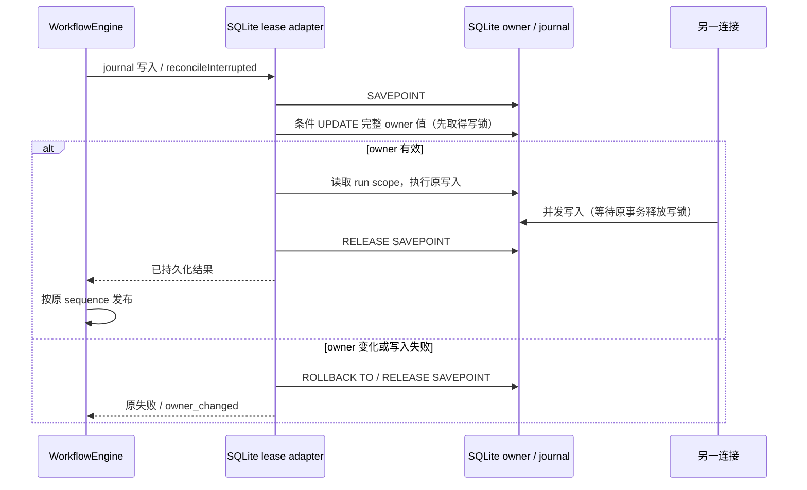

# 工作流 journal 写入的 SQLite 锁顺序

## 问题与规则

工作流运行期间的活动回调通过执行 lease 写入 journal。原实现开启 SAVEPOINT 后先读取 owner 和 run，再写事件；WAL 模式下另一连接若在读写之间提交，原事务无法从旧快照升级为写事务，抛出 `SQLITE_BUSY_SNAPSHOT`。活动定时器上的异常可进一步导致 Agent 退出。增加 busy timeout 无法修复这个快照升级冲突。

本次修复限定于既有 journal 写入事务的锁顺序，不调整模型重试、会话工作区身份或数据库 schema。

## 所有者、接口与顺序

- `acquireWorkflowJournalOwner` 继续唯一拥有执行 lease；使用现有 session KV 的完整 owner 值、workspace、generation 和进程身份进行 fencing。
- 同步 `JournalStorePort`、`WorkflowJournalOwnerLease` 及调用链不变。SQLite adapter 在同一 SAVEPOINT 中，以匹配完整 owner 值的条件 UPDATE 取得写锁并验证 owner，然后读取 run scope、执行原写入。
- 条件 UPDATE 不改变 owner 值、generation、状态或更新时间。没有匹配行时继续抛出 `owner_changed`，不得写入新 owner 的 journal。
- 不新增缓存、写队列、重试或超时预算。真实持久化失败继续返回原异常；不得丢弃事件、发布尚未持久化的成功或绕过执行 lease。
- `reconcileInterrupted` 复用同一事务入口。嵌套调用保留外层事务；失败仅回滚自己的 SAVEPOINT。
- journal 成功追加后，Engine 才向原 driver 发布同一事件。桌面 continuous 与手机 replayable 继续使用原 sequence、publisher 和恢复入口。

## 验收

1. 使用真实 WAL 数据库和两个独立连接，在 owner 读取后、事件写入前插入竞争写入；本 owner 的活动事件成功且只追加一次，竞争连接在事务结束后可继续写入。
2. 相同交错下 `reconcileInterrupted` 只结算一次，不发生旧读快照升级错误。
3. 完整 owner KV 值及更新时间不因 journal 写入改变；新 generation 仍拒绝旧 owner 的每次写入及迟到 release。
4. 内层写入失败时保留原异常，回滚内层事件，外层事务中的其他写入仍可提交。
5. 现有同进程与多进程 owner 认领、scope 隔离、CAS、journal 和工作流活动回归通过。
6. 真实活动 emitter 的延迟回调经 WorkflowEngine 写入 SQLite，在同样的竞争窗口下不会抛出未捕获锁异常；活动只持久化和发布一次，原 ask 仍可正常完成。
