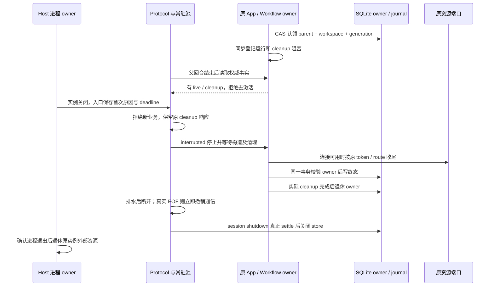

# 工作流中断修复增强实施报告

已按 A → B/C → D → E 完成本轮源码修复、测试补充与本机验证。父回合结束和常驻池回收现在读取同一组运行事实；真正关闭时保留首次原因、先封闭业务准入再排水；共享 journal 的执行权受到代际校验保护。此前 Browser 作用域与子代理创建事务修复保留并参加回归。

实施起点为 `e1e1acfc`，应用版本仍为 3.18.8。当前源码与隔离 Host 验证通过；没有安装发布包、升级运行中的原应用或自动重跑原失败业务。原日志能确认 Protocol 关闭后发生工作流取消，仍不能确定最早关闭调用者，也不能据此认定供应商不稳定或模型主动停止。

## 阶段结果与提交

| 阶段         | 实际完成                                                                                                                  | 提交       |
| ------------ | ------------------------------------------------------------------------------------------------------------------------- | ---------- |
| A            | 首次 ProtocolShutdownContext、IO/信号分类、绝对 deadline、Host 原实例清理意图；pending 与 failed 分开；移除入口遗留监听器 | `f18b3be9` |
| B/C          | 权威 residency snapshot、实际去激活同步复核、重入 gate；关闭时保留原资源 cleanup RPC 与 ACK；在途 App 构造纳入 drain      | `88031fa8` |
| D            | SQLite 现有 KV 中的执行 owner、完整值 CAS、事务内 journal fencing、带证明的孤儿收敛；启动失败回收未发布 lease             | `c6073acf` |
| 新发现问题   | 迁移测试核对当前目录完整 ID 集合，消除历史固定数量断言失效                                                                | `0ed54242` |
| E            | undefined 编译错误增加字段修复提示；取消与 HTTP/2 清理异常回归；真实状态组件的停止原因 E2E                                | `ac2cdb81` |
| 运行装配验收 | 隔离 Electron 主进程、真实 Host manager、stdio Agent 夹具、真实 Core/引擎/SQLite/Protocol                                 | `437794a0` |

实现详情及接口契约见[修复方案第 9 节](workflow-run-interruption-repair-plan-2026-10-14.md#9-实施契约2026-10-15)。

截至 `437794a0`，本轮实现与测试提交涉及 64 个文件，新增 2,264 行、删除 195 行；不含本报告及最终文档收尾。代码主要位于 CLI contracts、bootstrap、adapters、dynamic-workflow 和 services 的 Host 进程管理；Web 与 Desktop 新增内容用于验证。

## 所有者与事件顺序



Host 记录其已有 pid、runtimeInstanceId、generation 和首次 termination reason。CLI 自己持有 closeId；当前协议没有可信的跨进程 closeId 握手，因此不强行拼接两个 ID。未知来源继续标为 unknown，不能用时间接近替代身份关联。

Desktop 的 continuous 与手机的 replayable 继续使用原投递边界、CommandInbox 和 attachment owner。本轮没有增加第二份运行计数、任务队列或自动恢复通道。

## 新发现并处理的问题

| 问题与原因                                                                  | 修复及依据                                                                                       |
| --------------------------------------------------------------------------- | ------------------------------------------------------------------------------------------------ |
| 宿主 deactivate 可同步发事件；此前 gate 在调用后安装，重入 admission 有空隙 | 调用前安装临时 gate，blocked/同步失败撤销，started 延伸到实际 completion；确定性重入测试覆盖     |
| shutdown 只枚举已返回 App，遗漏尚在构造的候选                               | 资源 owner 同步登记 construction flight，关闭等待晚返回 App 清理，不能提前关闭共享 store         |
| 本机进程启动时间曾使用 os.uptime，得到系统启动时间                          | 改为 process.uptime；OS 查询限制执行时间，无法证明则保持 unknown；避免把活 owner 当旧实例        |
| journal 已写终态、本地 settlement 尚未更新，被日志称为 foreign writer       | 改为一次性 debug 观测事件，不据此宣称跨进程冲突；执行权由 owner/CAS 判断                         |
| owner 准入失败发生在 runtime 构造前，存在自建 store 泄漏风险                | 失败时只关闭当前 App 自建 store，借用的 Protocol store 保留；清理再失败时保留两份原因            |
| 两处迁移测试仍写死 23 条，当前基线已有 25 条                                | 比对当前迁移 ID 全集，保留失败后连接关闭及重试完成迁移的断言；没有修改 migration                 |
| CLI complete 残留入口信号/IO 监听器                                         | complete 幂等移除监听器并解除输入绑定，测试验证数量恢复                                          |
| Electron 验收夹具最初进入生产 src，跨 CLI 入口导入导致 rootDir 类型检查失败 | 迁入 bootstrap/scripts；不扩大生产 rootDir 或公开 API，重新执行 CLI 类型检查及 Electron 验收通过 |

Bug 的原因和修复依据已在相关实现中补充中文注释。

## 验证结果

实际使用 Node 24.21.0、pnpm 10.34.6，与 mise.toml 一致。隔离 Electron 为 41.10.7，其内嵌 Node 为 24.18.0；stdio 后端由固定 Node 24.21.0 启动。当前 Windows 环境没有 mise 命令，调用时显式选用固定版本运行时。

| 验证                                                 | 结果                                                                         | 本机证据                                                               |
| ---------------------------------------------------- | ---------------------------------------------------------------------------- | ---------------------------------------------------------------------- |
| 工作区 freshness                                     | 通过；无跟踪分支而跳过该项比较，相对 origin/main 落后 1 个提交，低于阈值 50  | `freshness-final.log`                                                  |
| 根 pnpm typecheck / pnpm lint                        | 均通过                                                                       | `.artifacts/workflow-interruption/root-typecheck.log`、`root-lint.log` |
| CLI typecheck                                        | 27 个任务成功，夹具越界已修复                                                | `cli-typecheck.log`                                                    |
| CLI lint                                             | 14 个任务成功，无错误和警告                                                  | `cli-lint.log`                                                         |
| pnpm verify:pre-push                                 | Lint 与架构检查通过                                                          | `pre-push.log`                                                         |
| architecture:check --changed                         | 违规 0、基线违规 0、新违规 0                                                 | `architecture.log`                                                     |
| 本轮修改文件格式检查                                 | 61 个源码/测试文件通过                                                       | `format-check.log`                                                     |
| 关系图校验                                           | 93 个节点、137 条边；ID、边端点和 rank 有效；本轮 3 节点、6 源码 seed 可解析 | `feature-graph.log`                                                    |
| Bootstrap 全部 src 测试                              | 509 通过，0 失败/跳过                                                        | `bootstrap-tests.log`                                                  |
| SessionStore、trust store、process owner             | 87 通过，含真实多进程共享 SQLite 与旧代写入拦截                              | `storage-tests.log`                                                    |
| Core 子代理、snippet、rewind、runtime close 定向回归 | 56 通过                                                                      | `core-tests.log`                                                       |
| 模型 runner、CLI 生命周期、schema 诊断               | 去重后另计 18 通过；同次运行的 6 个 storage/probe 测试已计入上一组           | `owner-model-schema-cli-tests.log`                                     |
| Browser broker 跨桥装配                              | 1 通过                                                                       | `browser-bridge.log`                                                   |
| Web 真实组件 E2E                                     | 11 通过；含宽屏/手机、中英文、明暗主题                                       | `web-e2e.log`                                                          |
| 隔离 Electron Host                                   | 1 通过；主回合完成仍保活、状态 lane 独立退休、显式关闭归因                   | `electron-host.log`、`electron-host-latest.json`                       |
| Desktop Agent 构建                                   | 通过，约 17 MiB                                                              | `desktop-agent-build.log`                                              |
| 新 bundle 实际 staging                               | 1 通过，校验字节一致及当前 authoring 指引                                    | `bundle-staging.log`                                                   |

去重计数为 670 个后端测试；另外 Browser bridge、bundle staging、Web、Electron 合计 14 个，共 684 个测试通过。重复定向执行没有重复计数。没有以全仓格式检查替代本轮文件检查，也没有把未执行的全平台或原业务测试计为通过。

架构工具将 CLI 与 services 识别为 unmanaged；已生成和读取对应受控上下文，但“检查通过”只代表当前策略覆盖范围内无违规，不代表它已扫描所有 CLI 依赖边。

### 运行验收的证据边界

Electron 测试加载当前 LCodeAgentProcessManager，后端夹具使用真实 Core、工作流引擎、SQLite owner、Protocol server、常驻池及 NDJSON connection。父模型返回固定文本，文件读取由显式 deferred 控制；不访问真实供应商，不执行原业务脚本。

实际验收过程：父回合完成 → 后台 run 等待文件读取且仍 running → 独立 MCP 状态进程因 idle-timeout 退出 → 主 run 继续 → 放行后完成 → 再启动 run → 显式 disposeWorkspace → 后端收到 stdin_eof → journal 收口 stopped/interrupted，service.closing 与入口 closeId 一致。

- 验收夹具 bundle SHA-256：`906701ef43b3faed3b0ec1885c31c995cd4108b10fcc4e5b092dcaba8c151ee0`。
- 实际 Desktop Agent 构建产物 `apps/lcode-cli/packages/cli/dist/lcode.cjs` SHA-256：`ebeda51a56fedaf146c0239b4de6f2620154c3f0df6691c4118e014d4af16144`。

两个 hash 对应不同用途。前者运行了隔离生命周期夹具；后者完成构建和 staging 检验，尚未替换运行中的安装包。

## 验收场景对应

| 方案场景        | 实际证据和层级                                                                                                                                    |
| --------------- | ------------------------------------------------------------------------------------------------------------------------------------------------- |
| LI01–LI03、LI05 | Core + workflow lifecycle + pool 装配；将 TTL/水位设为立即触发，两个 run 逐个完成，仍有 run 时无关闭副作用；Electron 验证真实父回合结束           |
| LI04            | lifecycle 测试让 lineage release 首次失败；终态可读、cleanup 保留 pin，重试完成后释放                                                             |
| LI06–LI07       | 构造失败回滚、失败资源句柄、在途构造 drain、新 blocker/App 替换、blocked 不扣容量、同步重入 gate                                                  |
| LI08–LI10       | shutdown-drain、transport-shutdown、runtime-cleanup、CLI lifecycle；新业务拒绝、原 cleanup ACK 接收、IO 原因分类、budget pending 不提前关闭 store |
| LI11            | 原 Browser route/generation 的迟到 ACK、旧 turn 结果、原连接清理及 storage 旧 owner 写入拦截回归                                                  |
| LI12            | Electron 中真实独立状态 Host manager 退出后主 lane 的 run 保持 running                                                                            |
| LI13            | 现有 owner/attachment 路径保留；新增多进程共享 journal 证明第二执行者被拒。没有把此项写成真实两个窗口的全链路验收                                 |
| LI14–LI16       | 独立 Node 进程共享 SQLite：活 owner 拒绝第二方；退休后两方竞争只一方成功；旧写者被 fence；未知、损坏、旧行缺元数据不被标死                        |
| LI17            | 原 stop/Amend 语义与投影回归、四类停止原因真实 UI 组件 E2E；Electron 退出写 interrupted                                                           |
| LI18            | caller abort + HTTP/2 异常只生成 cancelled，无 provider retry；iterator.return 错误只记清理事件                                                   |
| LI19            | Bootstrap 中 continuous/replayable、分片、冷恢复、ACK、CommandInbox FIFO 与重复 admission 回归；没有连接真实手机设备                              |
| LI20            | 同路径异 identity 的 child observation、worktree attachment/reference 与 owner workspace key 拒绝场景；没有跨真实远端 Host 的联机演练             |
| LI21            | Web 11 项浏览器 E2E，1280/390 宽度、中英文、明暗主题，停止原因与 resumable 标记正确                                                               |
| LI22            | 不合法 undefined 保留编译拦截，含行列与字段路径、可选字段提示；合法省略、合法值和 nullable 分开通过                                               |
| LI23            | 既有 import-reuse 测试：冷恢复复用已完成 occurrence，world.run 副作用不重放；同 run 的 lineage lease 不复用旧实例                                 |
| LI24            | 隔离真实 Electron Host 验收通过，版本与夹具 hash 已记录；原安装包和真实模型不在此断言内                                                           |
| LI25            | journal 先终态、本地 settlement 后到的确定性测试，不产生 foreign writer 警告、不提前撤销 live 事实                                                |

## 兼容与剩余边界

数据库没有新增表、列或 migration；新执行元数据使用现有 local_setting。已知旧 owner 退休后，新 owner 通过 CAS 接代；journal 写入在同一事务校验 token 和 parent，迟到旧写者不能覆盖新代。

缺 owner 元数据且存在非终态旧 run、跨主机无法证明退出、元数据损坏/未知版本时，执行认领返回 owner_unknown 并保留历史。当前没有自动绕过该限制的恢复入口；这类旧会话需要另行确认退休证据后处理，不能直接批量改成 interrupted。旧二进制不具备新 fencing，回退须先停止并退休新 owner，不能并行运行新旧 writer。

本机验证为 Windows；没有运行 macOS/Linux 真实进程探测、手机真机、跨 Host 联机、原安装包或真实供应商请求。既有两条 server_error 仍是独立网络问题证据，不因取消回归通过而宣称供应商故障已经消除。

保留了任务开始前的远控重连本地改动和已有 artifacts；提交只包含本轮工作。没有改动依赖锁文件、发布版本、原会话数据或用户业务脚本。

## 复核入口

从仓库根目录使用固定版本运行时执行检查。测试文件清单应以当前 rg --files 结果为准；当前本轮关键新增入口如下：

```text
node --import tsx --test apps/lcode-cli/packages/bootstrap/src/lcode-protocol/workflow-residency.test.ts apps/lcode-cli/packages/bootstrap/src/lcode-protocol/shutdown-drain.test.ts apps/lcode-cli/packages/bootstrap/src/lcode-protocol/runtime-resources-drain.test.ts apps/lcode-cli/packages/bootstrap/src/lcode-protocol/transport-shutdown.test.ts
node --import tsx --test apps/lcode-cli/packages/adapters/src/storage/session-store/workflow-owner.test.ts apps/lcode-cli/packages/adapters/src/storage/workflow-process-owner.test.ts
node --import tsx --test apps/lcode-cli/packages/cli/src/protocol-lifecycle.test.ts apps/lcode-cli/packages/dynamic-workflow/src/schema/diagnostics.test.ts apps/lcode-cli/packages/adapters/src/model/runner-event-order.test.ts
node --test packages/web/test/workflow-stop-reasons.test.mjs
node --test packages/desktop/scripts/workflow-lifetime-electron.test.mjs
node --test scripts/workflow-snippet-bundle.test.mjs
```

完整分组日志位于本机 `.artifacts/workflow-interruption/`，不提交测试数据库、临时 bundle、内部诊断或运行日志。
