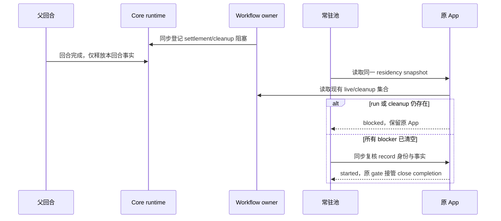
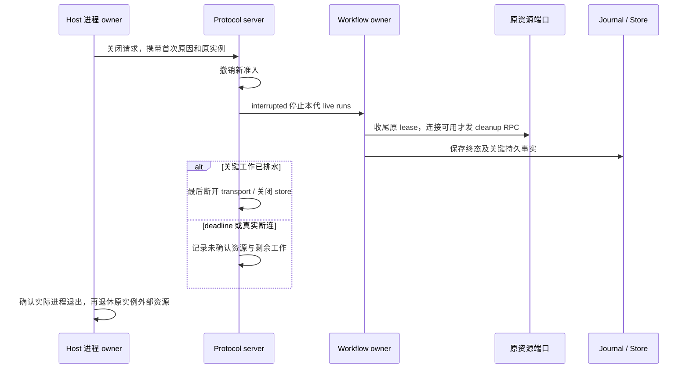

# 工作流运行中断修复增强方案

工作流应在父回合结束、切换详情或手机重连后继续执行；真正退出执行运行时才按中断收口。本次优先解决关闭原因不可追踪、运行与关闭边界不一致、收尾 RPC 被提前切断，以及跨实例孤儿收敛的所有权风险。

源码基线为 `473980ed`，仓库版本 3.18.8。依据为用户指定会话的分析、其附带日志及当前源码。本方案尚未实施；此前 Browser 生命周期修复保持有效，不能用其 555 项通过结果替代本次中断场景验收。

## 1 原分析需要修正的结论

原分析确认了 App 关闭会停止其 live workflow，这条链路成立。但“所有运行都被常驻池误回收”超出了现有证据，不能直接据此增加计数、延长 TTL 或取消正常关闭。

| 复核事实                                                                                                                                           | 对方案的影响                                                                                                   |
| -------------------------------------------------------------------------------------------------------------------------------------------------- | -------------------------------------------------------------------------------------------------------------- |
| 原日志包含 6,428 条记录，14 次 workflow tracking.started：7 次 CreateWorkflow、6 次 AmendWorkflow、1 次 ResumeWorkflowRun，涉及 10 个不同 runId    | 按启动尝试和 lineage 分析；Amend 可以主动停止前驱，Resume 也可能在创建阶段失败，不能把 14 次统称为同一种误杀。 |
| 8 次 service.closing 的 liveRunCount 大于 0；每个前后 1.5 秒窗口均有 sessions.shutdown.failed 和 runtime stopping 证据，部分窗口同时关闭多个父 App | Protocol 整体关闭是首要调查方向；同窗口未出现成功 resident_deactivated，仍不能用日志缺席证明常驻池完全无关。   |
| 21:00:44.938 父回合结束，21:00:45.005 服务关闭，21:00:45.009 后台任务被标为 cancelled                                                              | 67 毫秒的先后关系已确认，最早关闭调用者尚未记录。时间为北京时间，原日志使用 UTC Z 时间。                       |
| 当前 trackSettlement 已把 cleanup 同步登记至 retainSessionStoreDependentCloseWork，再由 Core 增加 residency 阻塞计数                               | 不能假设当前源码缺少保活登记；需要验证登记的 Promise、runtime 实例和实际运行 bundle。                          |
| record 的 residencyFinalizationCount 与 pool 的 operationLeaseCounts 是两套不同范围的计数；前者释放函数不直接调用 pool.rebalance                   | 原分析把两种 lease 的释放串成了确定因果链，需要补充真实回收触发点。                                            |
| 34 次 model.request.failed 中 32 次 reason 为 cancelled，2 次为 server_error                                                                       | 不能把 34 次失败都归为供应商不稳定；关闭引起的取消与真实服务端错误分开处理。                                   |
| 3 次 foreign_terminal_row 出现在本地仍认为 run 活跃的条目下；构造时 reconcile 仅按 parentSessionId 查非终态行并改为 interrupted                    | 已确认本地条目与 journal 终态存在观测差异；具体写入者未确定，跨实例 owner fencing 需要补齐。                   |

复核输出位于 `.artifacts/workflow-lifetime-followup/evidence.json`。复核脚本只读原日志，输出使用父会话和 trace 别名，不复制内部地址、业务脚本或用户消息。时间窗口与 trace 关联用于发现线索，不替代 owner 证明。

## 2 推荐产品规则

| 操作或事件                                     | 工作流行为                                                                | 唯一执行路径                                             |
| ---------------------------------------------- | ------------------------------------------------------------------------- | -------------------------------------------------------- |
| 父回合正常完成、进入 idle                      | 已接受的 workflow 继续执行，直到自身结算                                  | 原父 App 和 DynamicWorkflowRunService 保持所有权。       |
| 打开或关闭详情、切换任务、手机暂时断连         | 只改变订阅与展示，不生成停止指令                                          | 原 Host attachment 和 runtime；两种交付模式分别恢复。    |
| 常驻池 TTL 到期或达到高水位                    | 有 live run、cleanup、durable drain、输入或交互时拒绝去激活               | pool 读取 App 的权威事实，在首个副作用之前预检。         |
| 用户显式停止 run                               | 只停止指定 run，并保留 user 原因                                          | 原 workflow cancel owner，不用通用 taskStatus 猜测原因。 |
| Amend 替代前驱                                 | 仅前驱按 superseded 结算；新 run 正常取得独立所有权                       | 原 lineage 和导入契约。                                  |
| 显式关闭执行工作区、退出应用、升级或运行时退出 | 停止新准入，以 interrupted 收口，在预算内排水；历史保留，可按现有门槛恢复 | 原 Host 进程管理与 CLI 关闭 owner。                      |
| owner 身份未知或清理未确认                     | 不宣称资源已释放，不自动恢复执行或标记孤儿                                | 原 owner/lease 与 cleanup_pending 事实。                 |

本轮不把 workflow 改造成脱离 App 的后台守护进程，不默认增加模型重试次数或自动重跑中断任务。恢复继续走现有 ResumeWorkflowRun / revision 边界，已完成 ask 与已发生 world 副作用按原导入规则复用。

## 3 所有者与接口边界

| 状态或事实                                                      | 所有者                                 | 其他层如何使用                                                                |
| --------------------------------------------------------------- | -------------------------------------- | ----------------------------------------------------------------------------- |
| 进程、runtimeInstanceId、首次 terminationIntent、实际进程树退出 | LCodeAgentProcessManager               | Host 记录调度原因；不复制 workflow 运行表或业务队列。                         |
| stdin EOF、stdout close、信号和进程关闭 deadline                | createProtocolProcessLifecycle         | 保存第一次停止原因，后续幂等调用不能覆盖。                                    |
| 可执行 session record、去激活 gate                              | Protocol context / SessionResidentPool | READY、closing 与维护操作仍经过既有 gate。                                    |
| live run、settlement、pending cleanup                           | DynamicWorkflowRunService / lifecycle  | 同一个 runs Map 与 pendingCleanups 集合；新增只读事实接口，不新增运行计数表。 |
| turn、background task、retained work、store drain               | AgentRuntime                           | 原 residency 与 close-work owner；不能用 Renderer 的 running 标签替代。       |
| run 行、事件与 checkpoint                                       | 既有 journal / SessionStore            | 引擎正常写终态；孤儿收敛只在旧 owner 已失效且 CAS 成功时写。                  |
| 反向请求及原路由                                                | Protocol server 与各资源 port          | closing 期间仅允许精确已拥有资源的收尾；业务请求仍拒绝。                      |
| 展示与 optimistic overlay                                       | 原 V4 projection / UI                  | 读取 runStatus、stopReason、resumable；不拥有已接受队列或执行生命期。         |

身份 key 继续使用 `workspaceIdentity?.trim() || workspacePath`。文件操作使用真实 execution workspacePath；远程链路保留 remoteSessionId 和可信 attachment。诊断关联不能变成一条新的授权路径。

## 4 分阶段修复与增强

### A 先建立关闭归因和运行基线

**优先级 P0。** 先回答“哪个 owner、哪一代、因为什么关闭”，再决定修改哪条执行边界。

1. Host 的 stop/dispose/watchdog、CLI 的 EOF/output-close/signal、pool 的 TTL/LRU、显式 session close 分别记录结构化 origin。复用 Host 已有 runtimeInstanceId、runtimeIdentity 和 firstCleanupReason；不能只保留一条泛化的 runtime stopping。
2. 记录首次 close-request、准入撤销、live-run abort、critical drain、transport disconnect、进程退出六个阶段。共享 closeId；包含技术 session/run ID、实例身份、phase、实际 blocker 和剩余 deadline，不记录凭据、URL、正文或完整脚本。
3. Host 与 CLI 尚无可信实例映射时标为 unknown。需要跨进程传递元数据时优先扩展现有握手并做能力协商；同步严格类型和运行时 schema，不新建环境变量或放开 unknown wire 字段。
4. 回收决策日志附带 persisted、runtime work、live workflow、cleanup、交互、队列、订阅、operation lease 和 decision reason。成功去激活与“预检拒绝”分开留痕；高频逐条采样仍用 debug。
5. cleanup 日志区分真实异常与 400 毫秒单步等待预算耗尽。预算耗尽记录 cleanup_pending，不能用同一个 Error 类型让二者无法分辨。
6. 核对最小复现所用应用版本、Agent bundle hash、primary/mcp-status lane 和 runtime 实例。当前主聊天 service 排除了 idleTimeoutMs；该配置只用于独立 MCP 状态探测进程，不能把状态探测的空闲回收当作主进程默认行为。

**完成条件：** 一次运行中断可以从 Host 发起点追到 CLI 与 run 的终态；无法确认的最早原因明确标为 unknown。日志关联脚本按 run、attempt、parent、runtime instance 分类，不能对全局时间窗口使用第一个 turn.completed 直接定因果。

### B 使运行保活与去激活使用同一事实

**优先级 P1。** 不重复添加已有 registerResidencyBlockingWork；补齐真实装配与执行前闸门。

1. 通过 App 公共窄读面聚合现有 Core 和 workflow owner 的 residency 事实。建议接口名 `readResidencySnapshot`，属于拟新增接口；liveRunCount 与 pendingCleanupCount 直接读取现有集合，不维护第二份计数。
2. pool 与实际去激活入口消费同一 snapshot。有效 blocker 包含 live run、settlement/cleanup、store-dependent drain、Core turn/background work、待接受交互、CommandInbox pin 和订阅事实。
3. submit/amend/resume 在 launch 同一同步片登记阻塞，登记延伸到资源释放成功；绑定父 App 的具体实例，不按相同 sessionId 找后来重建的 runtime。
4. `deactivateSessionRecord` 在 unsubscribe、拆 projection、删除 record、app.close 之前同步复核全部事实及 record 身份。预检失败不触发任何关闭副作用。
5. 建议把 host 去激活启动面改为同步 `blocked | started(completion)` 结果，属于拟议契约；pool 只在 started 时扣 residentCount 与登记 gate，不能把异步拒绝当作成功开始回收。
6. 结算成功且 cleanup 排水完成后撤销 pin，恢复原 TTL/LRU 能力。保持现有 8/16 水位与 10 分钟 TTL，不用增加阈值掩盖错误。



**完成条件：** 真实 App + workflow service + pool 的装配测试中，父回合已完成、无订阅且超过 TTL/高水位时，run 不被 abort；settlement 与 cleanup 都完成后可正常回收。仅证明 mock 回调被调用一次不算通过。

### C 将准入撤销与收尾通信分开

**优先级 P1。** 当前 server.shutdown 开始关闭资源后立即 disconnectClient、清 messageSink；日志里的 checkout writer settlement failed / runtime stopping 与该风险吻合，但不能单凭它确认最早关闭原因。

1. 将进程关闭明确分为 quiescing、draining、transport-closed、retired 四个阶段。第一拍拒绝新 command、prompt、模型和 workflow launch；已有资源收尾仍归原 owner。
2. 连接尚可用的主动关闭中，允许精确已登记资源的 release/settle/close 反向请求。使用内部 cleanup-purpose 窄入口和严格 allowlist，校验原 scope、lease、runtime generation、workspace/attachment；不开放普通 execute、模型绑定或用户输入。
3. 等待 workflow settlement、actor dispose、关键 journal 写入、checkout/lineage lease 收尾及 store drain；Browser 等临时能力沿用原 cleanup_pending / late ACK，不冒称全部释放。
4. 同一 absolute deadline 管理所有阶段。单步预算到期允许推进其他独立清理，但不能把实际 close Promise 丢弃，或在仍可能写 store 时先关 SQLite。
5. EOF 或真实断连时无法恢复反向通信：立刻停止新的反向请求，在可用的本地持久边界写中断事实；原 Host 在确认精确进程树退出后处理其拥有的外部资源。不能在旧 transport 上无限重试，更不能向新 runtime 发送旧 cleanup。
6. 保留首次停止原因；关闭超时、stream iterator.return 失败和迟到 Browser finalizer 是收尾结果，不覆盖 run 的业务结算或中断原因。



**完成条件：** 主动关闭时 cleanup RPC 不再被“拒绝新业务”的闸门误拦；真实断连没有无限等待；durable drain 未完成时不提前关闭 store；同一关闭不会自动重演有副作用的工具。

### D 给孤儿收敛增加 owner 与 CAS 证明

**优先级 P1。** 构造一个空 service 不等于证明此前 owner 已死。

1. 进入根冷恢复、run Resume 和 journal reconcile 前，复用现有 Host owner/lease 路由确定当前 owner。若同一 session 有有效 owner，读者挂到原 owner，不能再构造第二个执行 App。
2. 原 owner 活跃时拒绝 claim/reconcile；原 owner 的有效性未知时保持只读观察并明确 unknown，不按 PID 不存在、单次心跳丢失或“本服务 runs 为空”直接写 interrupted。
3. 先区分同 owner 已提交终态、尚在本地 settlement/cleanup 的窗口，与真正的外来终态写入。现有 foreign_terminal_row 只比较本地 terminal 与 journal status，没有验证 writer；事件名字不能充当跨进程冲突证明。
4. 对已确认退休的旧代，用 owner generation 与 expected non-terminal state 的条件写入收敛。CAS 失败说明事实已变，重新读取，不无条件 updateRunStatus。
5. 旧 owner 的迟到结算与进度不能覆盖新代的 run；同 ID Resume 建立新的 attempt/generation，仍保留原 lineage、actor identity 和已完成导入。
6. 当前 JournalStorePort.updateRunStatus 没有传入 owner generation。若现有持久层不能表达必要 fencing，先设计迁移、兼容与回退，按仓库要求与模块维护者对齐后实施；方案阶段不修改数据库。
7. 旧版本或旧 run 行缺少 owner 元数据时，不批量认定为孤儿。混合版本期间只在已有可信退休证据下执行旧行恢复，避免新旧 writer 同时运行。

**完成条件：** 两个真实 service/process 共享同一 journal 时，第二个观察者不能把第一方活 run 标死；原 owner 退休后仅一个新 owner 取得执行权，旧代写入被拒绝。

### E 校准状态与失败诊断

**优先级 P2，部分可与 A 同时实施。** 复用已有状态和 UI，不重新建立运行状态 owner。

- 业务 runStatus / stopReason 是权威；后台追踪器把 stopped 映射为 cancelled 是通用词汇适配，不能据此展示“用户取消”。现有 get/list renderer 和 notification row 已读取停止原因，优先保证这些字段端到端一致及覆盖回归。
- user、superseded、interrupted、provider failure 与 cleanup_pending 分开。必要的可恢复异常信息通过现有 hooks / projection 展示；UI 不直接调用 Repo 或 window.lcode。
- cancellation 不触发 provider 自动重试；先保留原 abort 原因，再单独记录 HTTP/2 iterator cleanup 错误。两个 server_error 作为独立传输问题排查，不与整体退出混成一个计数。
- `baseline` 类型错误保留编译拦截。增强诊断时提供源码位置、字段路径及可选字段示例，不默认删除字段或绕过 report 类型契约；缺字段与显式 undefined 的序列化语义保持一致。
- 之前修复的 Browser authority、创建事务、child 只读详情、pending ACK、socket close 和失败资源句柄继续作为回归边界。本轮不通过随机新 sessionId 或恢复通用 child 输入绕过冲突。

## 5 源码落点与依赖顺序

| 落点                                                                                                                                       | 本轮用途                                                                                                         |
| ------------------------------------------------------------------------------------------------------------------------------------------ | ---------------------------------------------------------------------------------------------------------------- |
| `packages/services/src/lcode-agent/lcodeAgentProcessManager.ts`                                                                            | 复用首次 terminationIntent 和 runtimeInstanceId，补齐 Host 归因；区分 primary 与 mcp-status。                    |
| `packages/services/src/lcode-agent/lcodeAgentConnectionScope.ts`                                                                           | 保留 attachment、runtime identity 和订阅 ownership；断连不直接等同于 run cancel。                                |
| `apps/lcode-cli/packages/cli/src/protocol-lifecycle.ts`                                                                                    | 首次停止原因、输入/输出/信号路径、绝对关闭预算。                                                                 |
| `bootstrap/src/lcode-protocol/{server,runtime-cleanup,session-residency,session-resident-pool}.ts`                                         | 分阶段关闭、cleanup RPC、App snapshot 预检和真实去激活结果。以上 bootstrap 路径位于 `apps/lcode-cli/packages/`。 |
| `bootstrap/src/app/{app-dynamic-workflow,dynamic-workflow-run-lifecycle,dynamic-workflow-run-reconcile,session-resource-close}.ts`         | 原 workflow owner 的只读事实、登记与排水、owner 已失效证明和收尾顺序。                                           |
| `core/src/runtime/methods/{residency,session-store-dependent-close-work}.ts`                                                               | 保持单一计数及 drain；验证绑定到原 runtime 实例。core 路径位于 `apps/lcode-cli/packages/`。                      |
| `dynamic-workflow/src/engine/journal-types.ts` 及实际 journal adapter                                                                      | 需要时扩展条件写入公共契约；数据库迁移另行设计。dynamic-workflow 路径位于 `apps/lcode-cli/packages/`。           |
| `packages/shared/src/lcode-protocol/index.ts`、CLI contracts 公开入口                                                                      | 跨进程变化同步严格类型/schema 与兼容测试；不暴露私有 runtime 实现。                                              |
| `specs/workflow-run-status-presentation.md`、`workflow-observation-display-compatibility.md`、`workflow-reuse-and-large-run-visibility.md` | 统一停止原因、两种交付语义、恢复导入和已发生副作用边界。                                                         |

建议按 A → B/C → D → E 实施。B 的预检和 C 的排水分别评审，均不能通过取消正常 shutdown 解决。D 涉及持久 fencing 时单独提交，完成兼容验证后再启用。跨模块变更先运行 architecture:check 与受控 context；新增接口走公开入口，源文件仍遵守 400 行限制。

## 6 验收场景

以下为选定覆盖，不代表已经执行。新增真实 App/pool 和多进程 journal fixture；不使用固定 sleep 证明状态同步。

| ID   | 状态和动作                                         | 必须断言                                                                              |
| ---- | -------------------------------------------------- | ------------------------------------------------------------------------------------- |
| LI01 | 主回合结束，run 正在 model/tool 调用               | run 继续，controller 未 abort；root READY 与执行 owner 不变。                         |
| LI02 | live run 无订阅，TTL 到期                          | pool 返回 blocked，没有 unsubscribe、record delete 或 app.close。                     |
| LI03 | live run，resident 数超过 16                       | 只回收安全 idle App；没有因高水位中断 live run。                                      |
| LI04 | run 已结算，lineage cleanup 失败待重试             | 终态立即可读，App 仍被 pin；成功排水后可回收。                                        |
| LI05 | 两个 run 一个完成、一个仍执行                      | 不能因第一个 settlement 撤掉第二个 pin。                                              |
| LI06 | 创建/初始化失败或重复关闭                          | 原句柄保留且幂等，原因不被二次 close 覆盖。                                           |
| LI07 | 候选收集后出现新 blocker / record 被新代替换       | 执行前拒绝旧决策，不拆新代状态；容量计数不虚减。                                      |
| LI08 | Host 请求正常关闭，transport 尚可用                | 新业务被拒，精确旧 lease cleanup 允许，最后才断开。                                   |
| LI09 | stdin EOF / stdout close / signal                  | 首次 origin 准确；不无限重试反向请求，无重复停止。                                    |
| LI10 | 关闭预算耗尽，durable write 未完成                 | 明确 pending/未确认，不提前关 store，不报告全部 closed。                              |
| LI11 | 旧 cleanup ACK 或模型结果迟到                      | 只结算旧代；不修改新 runtime、attachment 或 Browser scope。                           |
| LI12 | primary 与 MCP 状态探测同时运行                    | MCP 状态 lane 空闲回收不停止主 lane 的 workflow。                                     |
| LI13 | 同一父会话由第二个窗口观察                         | 路由到有效 owner，不构造第二个执行 App。                                              |
| LI14 | 两个 process 共享 journal，一方仍 live             | 第二方不能 orphan reconcile 第一方的 run。                                            |
| LI15 | owner 退休、两个恢复者竞争                         | 一个 CAS 成功；失败方只重读，不双引擎运行。                                           |
| LI16 | owner 状态未知 / 旧行缺元数据                      | 不自行标死或自动执行；返回明确等待或恢复条件。                                        |
| LI17 | 用户 Stop、Amend、真实进程退出                     | 原因分别为 user、superseded、interrupted；generic cancelled 不抹掉区别。              |
| LI18 | canceled stream 的 iterator.return 抛 HTTP/2 错误  | 保留原取消原因，无自动重放或伪装成业务执行失败。                                      |
| LI19 | 两种 transport 的断连、重连和 snapshot             | continuous / replayable 保留各自语义，同一 CommandInbox 不丢、不重复接受输入。        |
| LI20 | 相同路径、不同 workspaceIdentity / remoteSessionId | 不互借 reader、lease、进度、清理或恢复 owner。                                        |
| LI21 | 宽屏/手机、中英文、明暗主题查看中断 run            | 现有停止原因、恢复入口与失败详情可读，无永久假 running。                              |
| LI22 | 编译 baseline 字段含不合法 undefined               | 不执行脚本；准确字段路径与位置，合法可选字段仍通过。                                  |
| LI23 | 有已完成 ask / world 副作用的 interrupted Resume   | 使用原 occurrence/lineage 导入规则，不重跑已确认成功工作。                            |
| LI24 | 隔离 Electron 真实 Host，安全小工作流              | 记录版本、bundle hash、runtime 实例、关闭归因；父回合结束后继续，显式关闭后正确中断。 |
| LI25 | 本 owner 已写 journal 终态，本地 cleanup 尚未结束  | 不误报 foreign writer，不允许 cleanup 未结算时重挂同代资源。                          |

只枚举会改变生命周期的维度：turn/run/cleanup 状态、关闭 origin、runtime generation、owner/lease、identity、delivery 与连接可用性。模型品牌、所有 actor 数量和主题不做全笛卡尔积；真实模型/原业务不作为单测依赖。

## 7 实施验证与交付

已存在的定向入口包括 `bootstrap/src/app/dynamic-workflow-run-lifecycle.test.ts`、`bootstrap/src/lcode-protocol/runtime-cleanup.test.ts`、现有 workflow model/driver/observation 回归及 Web 的工作流/side-pane 浏览器 E2E。App+pool 装配、关闭归因与多进程 fencing 测试为拟新增，不冒称已存在。

实施时实际执行：

```text
node scripts/check-workspace-freshness.mjs
pnpm architecture:check --changed
pnpm architecture:context <实际目标模块>
node --import tsx --test <已核对存在的定向测试文件>
pnpm typecheck
pnpm lint
pnpm --dir apps/lcode-cli typecheck
pnpm --dir apps/lcode-cli lint
pnpm verify:pre-push
pnpm --dir apps/lcode-cli --filter @lcode/cli build:desktop-agent
```

每阶段提交匹配 spec、行为测试、实现和真实验证结果。首个运行验收使用新 bundle 和隔离 Host 的无危险小脚本；旧日志和旧安装包不证明新改动生效。原失败业务由用户按恢复入口处理，不自动重跑。

本次方案复核已执行：原日志只读重算、相关定向测试 4 项通过、根仓库 typecheck/lint 通过。它们只建立当前基线，不证明 LI01–LI25 的新行为已通过。本轮没有修改运行代码、数据库或原会话，也没有关闭/重启原应用。

## 8 完成标准与回退

完成标准是父回合结束不停止已接受的 run；常驻池不回收仍有真实 blocker 的 App；真正关闭的 origin 可追踪，关键资源在原 owner 下结算；新观察者不标死活 owner；两种交付模式与恢复导入不重复副作用。

回退按阶段和配套 bundle 进行。B 的 App snapshot 与 pool 闸门一起回退，C 的 cleanup admission 与关闭顺序一起回退。D 的数据库回退方案先于迁移实施，保留旧终态与 lineage；不丢弃 owner fencing，也不靠恢复通用 child 输入、随机 actor ID 或无条件 orphan update 绕过问题。
