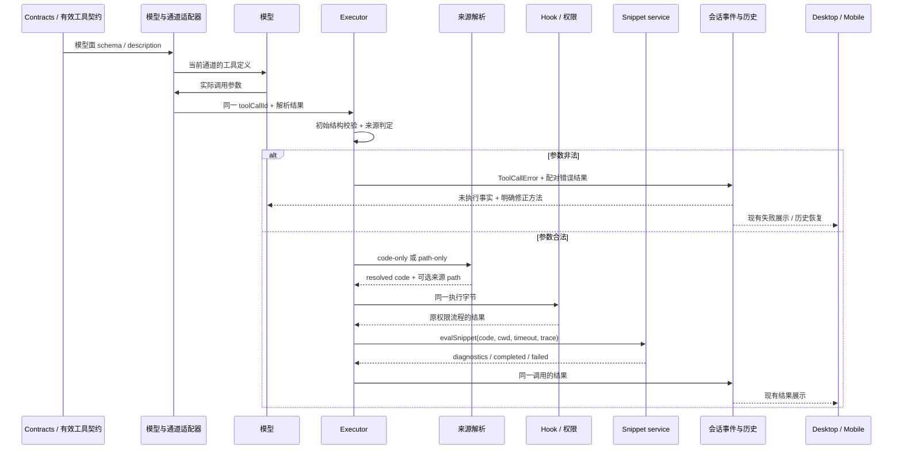

# 工作流片段调用契约与错误恢复增强方案

- 日期：2026-10-13。
- 状态：已授权实施确定性修复与增强；原问题外部必填签名仍需实际通道证据。
- 范围：`EvalWorkflowSnippet` 的来源契约、模型工具定义投影、错误反馈、作者指引及回归验证。
- 目标：合法调用在各层表达一致；错误调用在副作用前被拒绝；模型得到可以实际照做的修正方法；排查能找到契约变化发生在哪一层。
- 推荐顺序：先完成确定性反馈、作者指引及契约测试，再依据实际请求证据修复供应商或外部工具导出边界。保留现有工作流执行、恢复和修订语义。

## 1. 事实、假设与证据边界

| 项目             | 当前结论                                                                           | 证据与限制                                                                             |
| ---------------- | ---------------------------------------------------------------------------------- | -------------------------------------------------------------------------------------- |
| 第一次调用       | 同时传入 `code` 与 `path`，违反来源二选一约定                                      | 用户提供的拒绝调用记录；参数拒绝与当前工具规则一致                                     |
| 后续尝试         | 仍保留两个来源；把 `path` 改成 `/` 没有修正参数结构                                | 用户记录；“已经只传 code”的文字不能证明实际参数已经修改                                |
| 当前原始 schema  | `code`、`path`、`timeoutMs` 均可省略                                               | `contracts/src/tools/eval-workflow-snippet.ts`；当前源码探针得到 `required: []`        |
| 当前普通模型适配 | 本轮之前的 OpenAI、Anthropic、OpenAI-compatible 工具投影探针均保留空 required 集合 | 只证明探针覆盖的 `toAiSdkTools` 路径，不证明 SDK、最终 HTTP 请求或外部工具签名一定相同 |
| 二选一的位置     | executor 的工具专属 `validateInput` 在来源归一化前判定                             | 同时提供或都不提供时，拒绝先于文件读取、Hook、权限、handler 和端口执行                 |
| 合法内部输入     | 文件来源归一化后，同时包含 `code` 与 `path`                                        | `code` 是执行字节，`path` 是来源事实；该形状必须继续通过 Hook、审批和 handler 校验     |
| 作者指引         | `/lemon` 禁止 snippet 预检；通用工具描述和 dynamic-workflows 技能介绍支持片段测试  | 这是需要统一适用范围的指引差异；未证明原问题会话加载了 `/lemon`                        |
| 原问题的必填签名 | 未定位转换点，也未确认与当前源码属于同一版本                                       | 必须获取当时的实际工具定义、通道信息和安装构建身份，不能直接认定 Zod 或某供应商有 bug  |

用户记录中的路径与项目内容只是调查材料，不作为本方案的执行目标。验收使用隔离夹具，不创建或启动原 LAN 工作流，不修改原项目。

已确认的参数错误可以立即改善反馈；“可选字段变必填”仍是证据驱动的调查项。两者可能同时存在：一次调用确实非法，并不能证明向模型展示的契约没有问题。

## 2. 产品规则与本轮设计选择

### 2.1 保持来源语义

1. 模型提交内联片段时，只提供 `code`；文件来源时，只提供 `path`。`timeoutMs` 继续可省略，现有默认值与上下限不变。
2. 省略字段表示没有该来源。空字符串、`null`、虚构文件、目录及 `/` 不能作为“没有来源”的占位值。若某个真实通道需要不同的传输表达，必须在该适配边界明确转换，不放宽工具的标准输入。
3. 同时给出两个来源时继续拒绝，不默认选择 `code`，不默认选择 `path`，不静默删除字段。系统不能猜测用户真正授权的执行体。
4. 文件来源仍只读取一次。读取后的字节贯穿 Hook、权限检查与 handler；审批后不重新读取文件。
5. 来源二选一只作用于模型初始输入，不能对归一化后的 `code + path` 再执行相同规则。
6. snippet 读取整个文件，不剥离 workflow metadata；`CreateWorkflow.path` 的 metadata 与参数解析行为不受影响。
7. 不把所有 workflow 工具统一改成“必须恰好一个来源”：Create 与 Save 要求一个来源；Amend 最多一个脚本来源，全部省略表示沿用前驱脚本。

### 2.2 保持执行和恢复语义

- 输入拒绝不调用 `evalSnippet`、不执行 `world.run`、不创建后台任务或 durable run。
- 修正后的调用走原 executor、权限和端口；不由错误处理代码自动重放工具，也不重放已经执行的 sibling 调用。
- snippet 保持同步、瞬态；它的失败没有 `ResumeWorkflowRun` 语义。
- 新工作流仍由 Create 启动；恢复沿用 run ID；Amend 创建新 lineage。owner/lease、跨 Host 路由、stale-run 防护、并发准入、模型配置及 CommandInbox 不属于此次重构范围。
- 不通过增加超时、放宽 strict 校验、修改用户历史或忽略失败来消除问题。

### 2.3 推荐的接口策略

第一阶段保留 `{ code?: string, path?: string, timeoutMs?: number }` 的外部形状、现有字段名和运行时 schema。完整明确其“字段可选，但来源组合受规则约束”的含义。

不直接把现有共享 Zod schema 改为 `superRefine` 或排他的 union：该 schema 同时被初始归一化、Hook、审批及 handler 使用，排他约束会误伤合法执行态。即便以后增强模型面 JSON Schema，也必须与执行态 schema 分开，并保留工具专属来源判定。

现有 `DynamicWorkflowSnippetEvalRequest` 已要求 `code: string`，可以作为执行字节的窄契约，不必新增执行入口。若后续需要单独的 resolved 输入类型，应从共同字段定义派生，并测试 `prepareInitialToolExecutionInput` 在 path-only 原始输入上的行为，不能只修改 `runtimeInputSchema` 就宣称完成分层。

## 3. 状态所有者与事件顺序

| 事实或状态                           | 唯一负责方                                                   | 允许的派生或传递                                     |
| ------------------------------------ | ------------------------------------------------------------ | ---------------------------------------------------- |
| 字段类型、可选性、长度、timeout 范围 | contracts 的工具 schema                                      | JSON Schema、工具描述、测试夹具由当前定义派生        |
| 模型专属工具定义投影                 | 现有 model-contract 投影及模型 adapter                       | 必须与 executor 初始校验使用的有效契约同源           |
| 外部通道的请求编码与响应参数解析     | 相应 provider/adapter                                        | 只处理明确的传输差异，不持有业务执行状态             |
| 模型初始输入是否可接受               | executor 初始 schema 校验及工具 `validateInput`              | 错误反馈、遥测和现有 ToolCallError                   |
| 文件来源解析                         | 现有 `resolveInput` 与 `readWorkflowScriptFile`              | 将同一份代码字节和绝对来源路径传给下游               |
| 权限与命令确认                       | 现有 permission 流程、`prepareApproval`                      | 使用归一化代码，不独立读文件                         |
| snippet 执行与结算                   | DynamicWorkflowSnippetPort / service、既有 harness 与 engine | 同步结果、有限 logs、内存 journal                    |
| durable workflow 状态与 lineage      | 既有 RunService、engine 与 journal                           | 此方案不增加第二个 run owner                         |
| 用户看到的错误及恢复历史             | 既有会话事件、持久化和 UI 投影                               | Desktop continuous 与 Mobile replayable 使用同一事实 |



修改后的模型调用有新的 toolCallId；旧失败结果保留。重连回放仅重建展示，不重新执行失败调用或修正后的成功调用。

## 4. P0：让错误反馈可以直接指导修正

### 4.1 分清失败阶段

| 失败类别                          | 判定依据                 | 反馈应包含                                 | 后续动作                                       |
| --------------------------------- | ------------------------ | ------------------------------------------ | ---------------------------------------------- |
| JSON 无效或输入 null              | 现有 `inputError`        | 参数无法解析，工具未执行                   | 重交完整 JSON，不猜测供应商截断原因            |
| 字段类型、未知字段或 timeout 非法 | 初始 JSON Schema 校验    | 具体字段及类型/范围错误                    | 按真实 schema 修正字段                         |
| 两个来源都提供                    | 来源判定                 | 明确列出 `code` 与 `path` 冲突，片段未执行 | 根据实际意图删除其中一个字段                   |
| 两个来源都缺失                    | 来源判定                 | 缺少片段来源，片段未执行                   | 提供 code 或现存片段文件的 path                |
| 文件无法读取                      | 来源解析结果             | 文件来源失败，尚未执行                     | 修正文件；改用内联时用 code，不能同时保留 path |
| 编译诊断                          | service 返回 diagnostics | 具体 TS/工作流规则位置，未执行             | 修复代码后重新测试；Create 则按草稿 path 重交  |
| 执行失败                          | service 返回 failed      | 保留真实错误和已有 logs                    | 按实际错误调查，不将已发生效应描述成“未执行”   |

输入拒绝与执行失败必须区分；不能给所有失败统一加“没有任何操作发生”。文件来源失败之前可能已经发生了源文件读取，准确的说法是“片段未执行”，不应扩大为“没有进行任何 I/O”。

### 4.2 来源错误的推荐反馈

冲突反馈的关键部分应放在前面，确保经过现有 500 字符错误摘要仍然可用。示意文案如下，实施时使用现有工具结果包装：

```text
EvalWorkflowSnippet rejected the input before snippet execution.
Both `code` and `path` were provided; choose exactly one source.
For inline code, REMOVE `path` entirely. For a file source, REMOVE `code`.
Do not use null, an empty string, a directory or a placeholder path.
Inline shape: {"code":"return 1;"}
File shape: {"path":"snippet.ts"}
```

示例仅解释参数结构，不能诱导模型把用户片段替换成 `return 1;`。工具说明应要求保留原片段正文，仅修正来源字段；需要 timeout 时按原值保留。

缺少来源时返回独立反馈，不只复用“两者冲突”的一句话。schema 类型错误仍由现有字段级反馈负责，不把 null 或空字符串悄悄当作省略。

### 4.3 最小落地边界

- 先在 `eval-workflow-snippet.ts` 的专属校验中生成冲突与缺失的准确消息，复用 `ToolHandlerFailure -> createToolHandlerFailureError -> createErrorResult`。
- 保留现有错误分类、数值 code、ToolCallError、modelContent 和持久化路径。首版不新增共享协议 display 类型或数据库字段。
- 若遥测需要稳定区分冲突/缺失，单独增加有界内部判别信息，由专属校验生成、executor 传递；保留原 `error.code`，不得从英文文案解析业务状态。该小型内部契约需单独补 spec 与测试，不作为改善反馈的前置阻塞。
- 不建立一个会按工具名扫描输入、自动删除参数的通用修复层。
- 文件读取错误的下一步提示必须符合当前工具字段。若要增加共享读取错误的结构化原因，沿用 helper 的结果形状扩展，按真实 I/O 错误码归类；不能靠错误字符串猜测文件类型，也不能为此次问题增加重复读取。

## 5. P0：统一作者指引与修正流程

### 5.1 指引的适用范围

1. `/lemon` 的新任务保持直接 Create，不增加 snippet 前置步骤。
2. 普通 workflow 作者仅在某个确定性解析、过滤或 gate 逻辑确实需要验证时使用 snippet；它是可选工具，不是所有工作流的必经阶段。
3. 用户只要求理解或调查现有 workflow 时，不因为出现“工作流”一词就创建新的 run。
4. 内置命令、dynamic-workflows 技能和 Eval 工具描述同时写明上述范围，避免通用描述覆盖明确的命令约束。
5. 工具描述靠近开头给出两种合法来源示例；详细修正说明放到现有技能，保持当前工具描述预算。

### 5.2 模型的恢复约束

- 输入来源报错后先修正 JSON 结构，不编辑无关项目代码，不增加 timeout，不轮换虚构路径。
- 下一次实际请求必须反映修正：冲突场景中字段集合从 `{code, path, ...}` 变成 `{code, ...}` 或 `{path, ...}`。
- 保留原片段正文和有效配置，不为消除来源错误重新编写整个 snippet。
- 根据实际工具调用参数报告结果。不能以“我已改为只传 code”的自述替代请求证据。
- 若当前展示签名确实强制要求两个来源，而运行端又禁止两者并存，应明确记录这项边界矛盾，转入契约调查；不继续填 `/`、假文件或未经支持的 null。
- 不新增错误计数器、自动重试队列、全局工具次数硬停止或第二个恢复状态。相同错误仍诚实拒绝；会话利用已有结果修正当前调用，不牵连其他工作。
- Create 编译失败继续编辑工具返回的草稿并通过 path 重交；不回退到 snippet 来重复提交完整脚本。

## 6. P1：定位并修复 schema 转换边界

### 6.1 先取得实际通道证据

逐层对照下面的链路，而不是只检查原始 Zod：

```text
Zod schema
  -> toToolJsonSchema
  -> ToolRegistry.toContracts
  -> 当前模型的 model-contract 投影
  -> toAiSdkTools
  -> SDK / native request builder
  -> 外部工具导出或展示边界（如果存在）
  -> 模型实际收到的定义
```

需要记录：构建身份、插件内容来源与版本、provider kind、协议类型、已知的 SDK/adapter 版本、相关工具名、属性集合、required 集合、strict 状态、类型是否 nullable、组合约束及是否发生引用展开。不存在或无法取得的元数据标为 unknown，不用当前源码代替历史安装包。

对模型实际收到的定义，应优先使用安全的请求夹具或问题会话的脱敏记录。向模型展示的函数签名和 HTTP JSON Schema 是两个观察点；若签名由外部系统生成，单独核对其生成规则，不能默认两者等价。

### 6.2 根据证据选择修法

| 定位结果                                  | 对应修复                                                       | 不能采取的替代措施                               |
| ----------------------------------------- | -------------------------------------------------------------- | ------------------------------------------------ |
| 某个本地转换无意增加 required             | 修复该转换，保留原始可选性，并增加该路径的回归夹具             | 将 runtime 改成接受两个来源                      |
| 某个通道支持省略，但 SDK 默认模式改变语义 | 在该 adapter 显式使用保持省略语义的配置，以最终请求断言确认    | 对所有供应商统一启用/关闭 strict                 |
| 实际通道只能表达“字段必填且允许空值”      | 单独设计该通道的传输投影与反向解码，标准工具输入仍使用省略语义 | 将所有工具的 null 一律删除                       |
| 外部工具导出器把可选属性展示为必填        | 修复拥有该签名的导出边界，并交付转换前后证据                   | 修改 RunService 或重新生成业务工作流             |
| 源码、安装包、插件资产或会话来自不同版本  | 通过既有构建与插件分发链更新，核对实际加载来源                 | 手工覆盖用户插件缓存，或假设源码修改已经安装生效 |
| 当前路径无法复现变必填                    | 保留防回归测试，继续收集原问题定义                             | 宣布上游问题已经修复或保证所有通道支持省略       |

第三项是条件方案，只有真实通道证据成立才实施。其约束为：仅转换显式登记的“传输空值表示省略”的可选字段；在来源语义校验之前还原标准输入；保留有业务意义的 null，例如 Amend 的重置设定；不改变工具名、代码字节或无关历史。未经投影声明的 null 继续拒绝。参数解码由对应 adapter 持有，不能在 UI、RunService 或任意工具 handler 中各自补一套。

### 6.3 不把 oneOf 当作已经解决

模型面可以表达更强的来源互斥规则，但必须先验证当前通道的支持情况。仓库现有 `objectToolSchema` 会折叠函数参数根的组合分支；其测试也明确覆盖折叠行为。新增 oneOf 不能假定端到端保真，更不能修改所有工具的根投影来专门照顾 snippet。

因此首版推荐保留平坦 schema 与专属判定，补契约测试和明确描述。只有支持矩阵、最终请求和模型输入到执行器的往返验证通过后，才单独增强模型面 schema。执行态保持独立，旧调用形状保持兼容。

## 7. P1：建立有界、可关联的诊断

诊断复用现有 logger、trace 与工具遥测，不增加环境变量、业务队列、第二份会话状态或 UI 诊断面板。

- Schema 调查：在现有 debug 路径记录相关工具的安全结构摘要及 fingerprint，区分 registry、model projection、adapter 和最终请求阶段。摘要包含字段名与约束形状，不包含 schema 的示例值、默认内容或完整描述正文。
- Fingerprint 从确定性结构生成，只用于差异定位，不是身份凭据或授权依据。传输投影可以合法改变结构，因此比较允许有记录的转换，不要求不同阶段 hash 无条件相等。
- 输入拒绝：现有失败事件或遥测附带失败阶段、来源字段是否存在、相关字段类型/长度和标准化原因；通过 toolCallId、traceId、sessionId 关联。没有 run 时不虚构 runId。
- 不记录 snippet 正文、真实绝对路径、返回内容、凭据、完整请求/响应或内部地址。未知属性名在日志中不无界展开，只保留数量或受控摘要。
- 高频每条工具输入不新增 info 日志；schema 结构调查走 debug，debug 在生产不落盘。仅实际检测到契约不兼容时增加有界的 warn，并复用已有失败事件关联。
- 不用错误字符串做统计分类，不以 warning 次数驱动执行或恢复决策。

效果指标可以从已有事件或隔离基准计算：非法调用被拦截比例、反馈到模型的完整性、收到反馈后的来源字段修正比例、同类错误连续出现情况，以及新增 payload 大小。确定性验收要求错误调用执行次数为 0；真实模型的修正率作为观测指标，不能承诺 100%。

## 8. 影响边界与实施文件

下列路径均为当前仓库存在的入口；新测试另列，不能把计划文件当成现有覆盖。

| 优先级              | 文件或模块                                                                                               | 计划内容                                     | 边界理由                                               |
| ------------------- | -------------------------------------------------------------------------------------------------------- | -------------------------------------------- | ------------------------------------------------------ |
| P0 / must-inspect   | `apps/lcode-cli/packages/contracts/src/tools/eval-workflow-snippet.ts`                                   | 来源错误文案、字段说明与 schema 基准测试     | 输入契约来源；保持字段可选性与 timeout                 |
| P0 / must-inspect   | `apps/lcode-cli/packages/core/src/tool/handlers/eval-workflow-snippet.ts`                                | 冲突/缺失反馈、未执行事实、初始/执行态回归   | 来源组合的现有裁决点                                   |
| P0 / must-inspect   | `apps/lcode-cli/packages/core/src/tool/handlers/eval-workflow-snippet-description.ts`                    | 两种合法形状、可选预检范围、修正要求         | 模型常驻说明；预算不超过现有 6000 字符                 |
| P0 / should-inspect | `apps/lcode-cli/packages/lemon-workflow-plugin/commands/lemon.md` 及 `skills/dynamic-workflows/SKILL.md` | 对齐命令优先、可选 snippet 与失败恢复规则    | 内容插件是发布资产来源，不修改用户安装缓存             |
| P0 / must-inspect   | `core/src/tool/executor/call-runner.ts`、`validation.ts`、`errors.ts`                                    | 优先复用现有路径，添加执行器端到端断言       | 保证拒绝先于 Hook、权限和执行，且只产生一次闭合结果    |
| P1 / conditional    | `core/src/tool/model-contract.ts`、`registry.ts`、`adapters/src/model/tool-transform.ts`                 | 契约往返测试；仅在证据定位后修转换           | 描述符与有效初始校验必须同源                           |
| P1 / conditional    | `packages/provider-node/src/provider-auth/native/tool-schema.ts` 及实际 request builder                  | 最终请求保真测试；修复已定位的投影差异       | 通道转换属于 provider 边界                             |
| P1 / conditional    | `core/src/tool/handlers/workflow-path-source.ts`                                                         | 文件失败的准确分类和工具适用提示             | 四个 workflow 工具共用，不能破坏 metadata 或读一次语义 |
| invariant-only      | `bootstrap/src/app/dynamic-workflow-snippet-service.ts`、RunService、harness、engine                     | 保持执行行为，用计数与 journal 证据验证      | 本问题不是调度、缓存或恢复状态的重构理由               |
| evidence-only       | `packages/ui/src/ToolCallBlocks/renderers/eval-workflow-snippet.tsx`                                     | 验证错误可展开、无永久运行状态、恢复后仍可读 | 优先沿用既有 renderer，不新增“重跑”执行入口            |

现有 `specs/lemon-workflow-builtin-plugin.md`、`specs/tool-input-validation-feedback.md` 与 `specs/workflow-script-submission-and-revision.md` 在实际实现对应行为前同步更新；本文件是实施方案与验收边界，不宣称其建议已经生效。

feature-boundary 的 seed graph 当前未提供本问题的直接完整入口，记为 graph-drift-candidate。后续若补图，仅添加已核实的工具契约、admission 与反馈关系，不恢复不存在的历史模块，也不从图条目推断测试已通过。

引用追踪补充：`evalWorkflowSnippetToolEntry` 的 scoped dep:refs 找到 handlers/index.ts 的导入及注册。schema 导出经包 barrel 的 scoped 查询未找到静态引用，但当前 handler 明确导入它；这个零结果不是可删除证据，本方案保留导出和公开入口。

## 9. 代表性验收场景

以下 accepted 表示列入方案，不表示代码已实现或测试已通过。

| ID  | 分类                    | 前置与动作                                                        | 必须断言的结果与证据                                                                        |
| --- | ----------------------- | ----------------------------------------------------------------- | ------------------------------------------------------------------------------------------- |
| C01 | accepted                | 内联 code-only，不传 timeout                                      | 初始校验通过，默认 timeout 生效，端口只调用一次                                             |
| C02 | accepted                | path-only，隔离夹具有现存文件                                     | 原文件读取一次；归一化得到 code + path；权限与 handler 看到相同代码字节                     |
| C03 | accepted                | 同时 code + path；分别使用有效路径、不存在路径和目录占位          | 全部在来源判定拒绝；来源解析、Hook、权限、handler、端口执行次数为 0；准确反馈冲突           |
| C04 | accepted                | 都不提供，或只有 timeout                                          | 拒绝缺少来源，且明确 snippet 未执行                                                         |
| C05 | accepted                | code/path 为 null 或空字符串、timeout 超界、出现未知字段          | 原字段级错误仍拒绝；不把非法值转换成省略或有效来源                                          |
| C06 | accepted                | path-only，但文件不存在、不可读或指向目录                         | 来源解析失败，snippet 不执行；不自动转为 code、不伪造结果；跨平台错误分类有诚实 fallback    |
| C07 | accepted                | 文件以 workflow metadata 注释开头                                 | snippet 使用整个文件；Create 的 metadata 处理与参数校验不回归                               |
| C08 | accepted                | path-only 归一化后经过 Hook 或审批校验                            | 合法 code + path 不因二选一而拒绝；非法更新仍拒绝；不重新读取文件                           |
| C09 | accepted                | 纯读 snippet、带 world.run snippet、编译失败 snippet              | 保持现有权限语义；编译失败不执行；带命令的默认 ask 流程仍进入确认，不改变现有授权模式优先级 |
| C10 | accepted                | stub 模型先给冲突参数，收到结果后改为 code-only                   | 错误结果包含未执行与删除字段指引；原片段未改变；新调用执行一次，旧失败事件/结果各一次       |
| C11 | accepted                | 同一批存在另一个已成功的 sibling 工具                             | 修正 snippet 不重放 sibling；取消与工具去重原语不变                                         |
| C12 | accepted                | 同类错误重复出现但字段集合仍未修正                                | 每次仍准确拒绝，无执行；不由错误处理层自动重试或硬停整项任务，不清除失败历史                |
| C13 | accepted                | non-streaming、stream-end、during-stream 三种已有执行模式         | 同一拒绝语义、一次错误闭合、修正后一次执行；流式参数未完成时不提前判定或执行                |
| C14 | accepted                | registry、有效模型投影、adapter、实际 request builder 转换 schema | 原始合法形状往返仍合法；required/nullable 变化必须是显式策略；原 schema 不被原地修改        |
| C15 | undefined / conditional | 原会话确实只能表达所有字段必填                                    | 先取得定义与通道证据，再按第 6 节选择修法；此案未满足前不能宣布兼容性修复完成               |
| C16 | accepted                | `/lemon` 新任务与编译失败修正                                     | 命令指引不出现强制 snippet；首次单一 script；失败修草稿后单一 path；不启动重复 run          |
| C17 | accepted                | 通用作者可选预检与仅调查工作流的请求                              | 可选预检规则明确，调查不自动生成 run；内容和描述预算通过检查                                |
| C18 | accepted                | Desktop continuous 在线错误；Mobile replayable 断连恢复           | 现有错误事件、快照和历史均有效；错误详情可读；无永久 running/inputStreaming；重连不执行工具 |
| C19 | accepted                | 相同本地路径但 workspaceIdentity/remoteSessionId 不同             | 延用原身份与路由校验；不跨 workspace/会话读文件、展示错误或执行修正调用                     |
| C20 | accepted                | 已有 Create/Amend 的审批模型选项与运行恢复测试                    | 审批专属字段仍合法，模型伪造仍拒绝；Amend 的省略与 null 重置语义不回归                      |

### 剪枝与不扩展范围

- 不枚举所有供应商、主题、actor 数、Git 状态和 workflow phase 的笛卡尔积：来源校验不依赖这些维度。选择普通 adapter、实际 request builder 和异常转换夹具覆盖有语义变化的边界。
- 不把 UI 视口宽度等同于 transport 模式：桌面/手机布局用浏览器验收，continuous/replayable 用事件和协议验收分别证明。
- 不为这个输入错误重跑所有高并发 benchmark：调度没有修改且相关定向回归通过时，不增加无关验证。
- 不测试真实 LAN 联机项目或真实用户会话写入：执行副作用由隔离夹具计数和实际引擎/端口边界证明。

## 10. 测试落点与现有覆盖缺口

| 层             | 当前可复用文件                                                                                        | 计划新增或扩展                                                                   | 验证目的                                                        |
| -------------- | ----------------------------------------------------------------------------------------------------- | -------------------------------------------------------------------------------- | --------------------------------------------------------------- |
| 工具契约       | `contracts/src/tools/eval-workflow-snippet.ts`，目前未找到专门的 snippet 输入测试                     | 新增 `contracts/src/tools/eval-workflow-snippet.test.ts`                         | required、null/空值、timeout、未知字段、JSON schema 与类型契约  |
| 专属校验与解析 | 当前 handler，已有 `core/src/tool/executor/call-runner.test.ts`                                       | 新增 `core/src/tool/handlers/eval-workflow-snippet.test.ts` 并扩展 executor 用例 | 两类来源错误、拒绝先于副作用、path 读一次、合法 resolved 输入   |
| 会话恢复       | `core/src/runtime/methods/model-tool-input-recovery.test.ts`                                          | 增加真实 snippet entry + stub 模型/端口的修正用例                                | 配对结果、三种执行模式、保留代码、不重放 sibling                |
| 模型面与执行态 | `core/src/tool/executor/validation.test.ts`、`workflow-model-approval.test.ts`                        | 补归一化来源与审批保真断言                                                       | 避免 public XOR 误伤 runtime 事实                               |
| Provider       | `packages/provider-node/src/provider-auth/native/tool-schema.test.ts`                                 | 加入实际 Eval schema，通过现有 request builders                                  | optional、root projection、namespace、不可变性、最终请求        |
| Adapter        | `adapters/src/model/tool-transform.ts`、`tool-input-normalization.test.ts`                            | 如需要，新增 `tool-transform.test.ts`；条件传输解码另加专用测试                  | 当前 ordinary projection 不改变来源含义，非法 JSON 不伪装成缺参 |
| 作者规则与打包 | `core/src/tool/handlers/workflow-tool-description.test.ts`、`scripts/lemon-workflow-builtin.test.mjs` | 扩展适用范围、示例与内容分发检查                                                 | 指引一致、预算保留、实际构建含更新内容                          |
| 显示兼容       | `bootstrap/src/lcode-protocol-v4/workflow-observation-compatibility.test.ts`                          | 扩展输入拒绝的既有 ToolCallError 与快照回放                                      | 不引入旧 strict reader 不认识的字段                             |
| Browser E2E    | `packages/web/test/workflow-execution-progress-browser.mjs` 与既有 progress 测试                      | 新增 `packages/web/test/workflow-snippet-recovery.test.mjs` 及所需隔离夹具       | 真实 snippet renderer 显示错误、重挂后仍可读、窄屏与国际化      |

现有 progress 浏览器测试不执行 workflow/model，也未证明 snippet 修正闭环；不可把它列为本问题已经覆盖的 E2E。新场景使用现有浏览器启动设施，宽屏与 390px 手机布局，代表性明暗主题、中英文，核对长错误换行、详情展开及恢复。没有修改 UI 样式时不新增布局方案；若需新增文案或交互，再遵循 DESIGN.md、共用组件、字体 token 与两种语言。

单元和集成用例使用临时目录、受控文件系统、stub 模型、端口计数和已有事件库。文件 I/O 为异步；测试不依赖固定 sleep，等待确定的调用、事件、ACK 或结算事实。假模型用例证明恢复链路，不等同真实模型一定正确选择下一步。

## 11. 实施拆分与检查

### 提交 A：契约说明与反馈

先更新对应 spec 和新增 C01-C08/C10 的失败用例，再修改来源错误反馈和作者说明。保留现有 public shape、执行态与权限行为。交付可查看的输入、错误、修正调用及副作用计数证据。

### 提交 B：跨层契约回归

扩展 registry/model-contract/adapter/request-builder 用例以及 C13/C14/C20。收集来源签名的变化证据。若当前源码路径没有重现转换错误，只提交防回归测试和调查结论，不编造修复代码。

### 提交 C：已定位的适配修复（条件提交）

只修改确认有问题的转换层。先建立会失败的最终请求或往返用例，再实施修复。合法 schema 与 canonical 输入一致；原 public 调用不改变；其他工具有实际 null 语义时保持原样。无法定位就不实施此提交。

### 提交 D：可观察性、展示与分发验证

补有界诊断及 C18。UI 如无需改动，仅增加覆盖。构建含更新内容的实际发布资产，核对内置插件命令/技能和 Agent 工具 schema；需要更新手机静态资源时按现有独立分发边界处理。构建不自动安装、部署或修改原用户会话。

### 必需检查

实现代码之前使用 architecture-governance：先跑架构检查，再读目标模块受控上下文。上述核心代码属于当前策略的 `lcode-cli`；若改 provider-node，则一并检查其公开入口和依赖边界。文档方案本轮不修改运行代码，也不将文档检查当作实现验收。

Node 与 pnpm 使用当前 mise.toml 的 24.21.0 / 10.34.6。实现后至少执行：

```text
pnpm typecheck
pnpm lint
pnpm --dir apps/lcode-cli typecheck
pnpm --dir apps/lcode-cli lint
pnpm architecture:check --changed
pnpm verify:pre-push
git diff --check
```

定向测试使用当前存在的 `node --import tsx --test <实际测试路径>`，按触及范围选择；新文件落地后才能加入执行清单。格式检查针对实际触及文件。需要刷新包构建时使用对应 package.json 的现有 build 命令，不假定根 typecheck 覆盖 CLI，也不假定存在统一 test/e2e 入口。已有失败、跳过、运行环境偏差和未验证的平台必须如实报告。

## 12. 发布与完成标准

发布验收分为三层，不互相替代：

1. **源码层**：无效组合在副作用前拒绝，合法来源和内部 resolved 输入通过；相同调用产生一次配对结果；修正后执行一次；相关类型、Lint、架构与定向测试完成。
2. **构建层**：实际 Desktop Agent、CLI/SEA 或远端 Agent 的适用发布路径包含更新契约与内容；记录实际构建身份。已有 built-plugin 测试可能跳过缺失的产物，跳过不能写成安装包验收成功。
3. **问题通道层**：取得原问题的真实工具定义，确认可表达合法来源；在同类通道完成最小安全 snippet 的实际调用。没有这层证据时，只能宣布确定性反馈/防回归增强完成，不能宣布历史必填签名问题已修复。

不修改历史失败，不停止或恢复无关 run，不覆盖用户自定义插件，不以手工缓存拷贝代替正式分发。若增加新的传输投影，回退应保持标准工具契约与旧数据可读，不能遗留“定义允许 null、执行器不认识”的半升级状态。

整体完成标准是：用户与模型看到可操作且准确的契约，错误能够定位到阶段和转换边界，所有副作用仍受原 admission/权限约束，桌面与手机恢复读到同一事实。方案不承诺模型永远不产生错误参数。

## 13. 本轮方案编写的验证记录

- 读取了当前源码、对应 spec、feature-boundary 规划模板、UI 规范和实际 package.json；按范围查询引用，没有修改运行代码。
- 基线 freshness 检查通过当前阈值；L-GO 没有远端跟踪分支，相对 origin/main ahead 33 / behind 1。
- 本轮运行了现有 validation、model-tool-input-recovery、workflow-tool-description、native tool-schema 四个测试文件：17/17 通过，0 skip。它们是现有边界的基线证明，不是本方案新增场景已经实现的证明。
- 执行环境当前 Node 24.14.1，与仓库锁定的 24.21.0 不一致；实施验收需使用锁定版本。未改变机器运行时或依赖。
- 原问题的安装包、外部函数签名、最终请求和真实模型后续调用尚未核对；没有启动原 LAN 工作流。
- 根 `pnpm typecheck`、`pnpm lint` 通过；新增方案文件的 `oxfmt --check` 通过。定向 `git diff --check` 未发现已跟踪差异，但新增文件仍未跟踪，不能把该命令当作它的独立差异验证；文件格式由 oxfmt 实际检查。
- 本轮仅新增这份方案文件，未改动已有 spec、技能 seed graph 或运行代码。未执行本方案的新场景、完整 CLI 检查、浏览器 E2E、构建安装及真实通道验收；这些属于后续实施清单。

## 14. 2026-10-13 实施边界

- 来源校验分别返回冲突与缺失消息，保留 `errorCode = 400` 与既有错误事件。模型必须能读到“片段未执行”和准确的字段删除指导；核心反馈不超过现有 500 字符摘要预算。
- 模型侧 schema 显式发送 `required: []`，明确 code、path 和 timeout 均非单独必填，不依赖接收层对缺失 required 的默认推断。来源组合继续由初始来源判定负责，执行态仍允许 code + path。显式空集合是契约表达增强，不视为已经修复尚未定位的外部签名生成器。
- 工具专属校验可附带内部 `sourceInputError`：`reason` 为 `conflict | missing`，`fields` 为工具声明的来源字段。executor 只用它生成有界 debug 诊断，不新增共享协议字段，不从错误文案判定状态，不持久化第二份恢复事实。
- debug 诊断只记录有效 schema 的来源字段类型、required 摘要及结构 fingerprint；不读取或记录参数值。fingerprint 是调查摘要，不保证涵盖全部 JSON Schema 语义，不用于校验或授权。
- 共用文件读取函数增加可选的内联来源字段名称，默认保持 `script`；Eval 传 `code`，读取失败消息明确要求先删除 `path` 再传内联代码。只改反馈，不改变文件读取次数或 metadata 解析。
- 增加真实 executor 的拒绝/修正/Hook/审批测试、三种会话执行模式测试、schema 到 adapter/request builder 的保真测试和宽屏/手机错误历史显示验收。
- 使用已安装的 Node 24.21.0。实现不增加传输 null 转换或全局 strict 策略；没有复现的外部 required 变化保持待定位。
- 新增问题报告提供的模型 I/O 摘要进一步确认：provider-facing JSON Schema 无 required；同时会话展示签名仍将所有字段列为必填。工作流 skill 未被证实为故障源，本轮指引更新是恢复增强，不将其写成根因修复。
- 构建验收使用新生成的 CLI/desktop-agent bundle，并在隔离临时仓库中暂存完整官方内容插件，逐字节核对。隔离测试不覆盖运行中的桌面资源、不改用户插件缓存或已安装应用。

## 15. 实施结果与剩余证据（2026-10-13）

### 已落地行为

- 模型侧契约显式包含 `required: []`，来源字段描述要求省略未使用字段。初始来源校验分别返回冲突与缺失反馈，保留错误码与既有错误闭合路径；拒绝发生在文件解析、Hook、审批和 snippet 执行之前。
- 冲突反馈直接要求删除实际 `code` 或 `path` 字段，明确未执行，保留原片段和有效 timeout。文件读取失败改为指导删除 `path` 后使用 `code`，不再错误建议 snippet 接受 `script`。
- 文件解析仍只读取一次，整个文件含注释原样进入执行态；归一化的 `code + path` 继续通过 Hook 和审批的 runtime schema，不增加第二次 XOR 判定。snippet port、权限策略、CommandInbox、owner/lease、workspace 身份与路由均沿用现有所有者和路径。
- 内部来源诊断只在 debug 记录拒绝原因、schema 阶段、来源类型、required 摘要及有界 fingerprint，不记录代码、路径或其他输入值；未增加共享协议字段或恢复计数器。
- 作者说明把 snippet 测试明确为可选，统一实际字段修正与调查范围；`/lemon` 继续直接 CreateWorkflow。技能更新属于恢复指引增强，未将其认定为报告故障源。
- 生产 TypeScript 新增净 100 行，其中 41 行为 schema 诊断帮助函数；provider 与 UI 生产实现未改动。源码、测试、内容与 spec 按同一个片段来源恢复功能审查，不包含条件提交 C 的未定位适配修复。

### 已执行验证

最终使用仓库锁定的 Node 24.21.0 / pnpm 10.34.6。PowerShell 中直接调用该 Node 执行测试；pnpm 通过 `volta run --node 24.21.0 pnpm ...` 执行，使嵌套命令保持相同 Node，不修改机器默认版本。

| 验证              | 实际结果与证明范围                                                                                                                                                               |
| ----------------- | -------------------------------------------------------------------------------------------------------------------------------------------------------------------------------- |
| 定向回归集合      | 15 个测试文件共 107/107 通过，0 skip；包含新增场景及既有回归，不表示运行了仓库全部测试                                                                                           |
| 来源与副作用      | 有效/不存在/目录占位冲突在副作用前拒绝；缺失、null/空值、非法 timeout/字段保持准确拒绝；修正保留代码与 timeout，只执行一次                                                       |
| 文件、Hook 与审批 | 文件读取后改写磁盘内容，Hook、审批和 handler 仍收到首次读取的完整内容；默认纯读与 world.run 的权限语义不变                                                                       |
| 会话修正          | stub 模型覆盖 non-streaming、end-of-stream、during-stream；故意换路径仍拒绝，真正删字段后成功；每个调用只闭合一次，不重放成功 sibling                                            |
| 契约转换          | 真实 Eval schema 在 registry 与四种 adapter、两种引用投影设置下保留可选性；native 实际请求构造器使用同形的可选来源夹具，保留 required、非严格策略与原输入不可变性                |
| 真实引擎          | 实际编译器和隔离子进程运行纯逻辑片段并捕获日志；actor 编译拒绝；执行异常保留此前日志，不声称未执行                                                                               |
| 协议与恢复        | 真实 executor 错误进入既有 V4 publisher；continuous/replayable 的 live、快照恢复与 transcript 冷恢复均保持错误可读，无新增 display 或协议字段                                    |
| 浏览器 E2E        | 1/1 通过，0 skip；真实结果与 UI renderer，1280/390px、中英文、明暗主题；宽屏键盘展开、手机触摸展开、无水平溢出，重载恢复已序列化结果。执行端口使用隔离替身，未连接真实手机或模型 |
| 类型、Lint        | 根 `pnpm typecheck`、`pnpm lint` 通过；CLI typecheck 27/27 任务、lint 14/14 任务通过                                                                                             |
| 架构与提交检查    | `pnpm architecture:check --changed` 与 `pnpm verify:pre-push` 通过，violations/baseline/new 均为 0；目标模块为现有 lcode-cli、provider-node、web，无新增模块依赖或状态所有者     |
| 内容与格式        | 工具说明预算、官方插件内容测试通过；实际触及 TS/MJS/HTML/spec 文件格式检查通过；技能嵌入示例保留原格式，只修改相关说明                                                           |

CLI 检查仍报告已有 Turbo 警告：lockfile 缺少 `packages/telemetry` 的 workspace 条目，不能计算完整闭包。检查最终成功；本功能不调整锁文件或依赖。

构建使用 `pnpm --dir apps/lcode-cli --filter @lcode/cli build:desktop-agent`，新产物为 `apps/lcode-cli/packages/cli/dist/lcode.cjs`，SHA256 为 `8a2763c06182c98bffcf92daabe6631b2f051753d3306ada1f5c47ff105aee6e`。隔离暂存测试强制要求已有产物，不允许缺失时跳过；使用正式 stageAgentBundle 路径核对 bundle 字节、更新的拒绝反馈/诊断标记与官方命令/技能内容。现有桌面内置插件发现测试也通过，但不以旧暂存目录中的内容发现替代新产物的隔离验证。

### 尚未证明的范围

- 新报告仍显示 provider-facing schema 无 required，而会话展示签名把三个字段列为必填；当前 checked-out adapter/native 路径没有重现这一步。显式空 required 与新增反馈不等于已定位或修复外部签名生成器。C15/条件提交 C 留待取得实际定义、生成阶段和同类通道最小调用证据。
- 未新增传输 null 解码、全局 strict 改写或 root oneOf。现有 native object projection 会展开分支，仅添加 oneOf 不能证明最终请求保留 XOR；共用 runtime schema 还必须接受合法的 code + path 执行态。
- 假模型证明同会话修正路径，不保证真实模型必然删掉正确字段；作者内容测试证明规则一致，不证明外部模型必然遵守 `/lemon`。身份/lease/跨 Host 路由没有修改，未新增 C19 的跨会话隔离实验。
- 已在 Windows 验证；未在 macOS/Linux、真实手机断连、原问题安装包或外部 provider 通道执行。未新建原报告工作流 run、修改历史失败、覆盖已安装应用、用户插件或运行中的桌面资源，也未发布远端资源。
