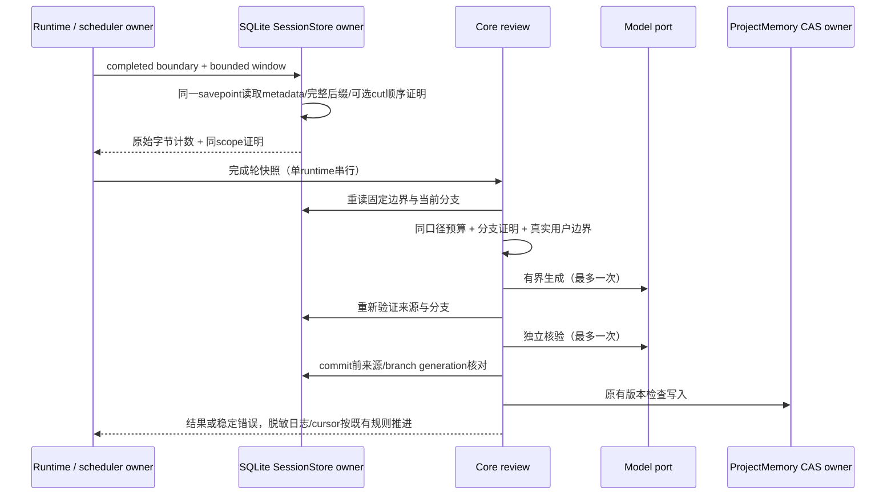

# 自动工作区记忆提取的预算与回退窗口修复

日期：2026-10-11。用户已要求修复调查发现的自动保存阻塞。本规格补充首版实施契约，不修改个人记忆、不触发历史会话付费补提取、不替换安装包。

## 已确认的问题

- SessionStore 的 `maxDataBytes` 定义为 admitted message/part 原始 JSON 数据列的 UTF-8 字节。Core 却把注入消息/part ID、sessionID、messageID 和容器后的 JSON 按同一上限再次检查，合法的接近 256 KiB 窗口会在模型请求前误报 `budget_exceeded`。
- 回退之后的长会话，cut 已落到窗口前缀之外时，Core 无法证明当前窗口位于新分支，因而一直跳过。不能通过直接忽略缺失 cut 来解决，否则会重新学习废弃分支。
- 旧自动输出上限为生成1536/核验768，已观察到 `length` 且正文为空。不能据此断言推理映射错误，但总输出预算需要为推理和结构化正文留出更合理的有界空间，失败原因也需要可查询的脱敏诊断。

## 所有者、接口和规则

1. SQLite SessionStore 继续独占持久会话、顺序与回退事实；Runtime 继续拥有轮后scheduler、cursor和取消。Markdown仍为唯一记忆事实源，所有保存仍走既有独立核验与CAS。
2. Core 按端口原始数据字节预算校验 `loadedDataBytes`，并检查消息/part行数及计数一致性。对解码材料另行累计去掉由行列注入的ID字段后的JSON payload字节，作为原始字节下界，拒绝超额payload或虚报计数；不把容器/行ID开销再次算进原始预算。输入模型的编码请求预算仍独立检查，不能因读取合格放开模型预算。
3. `SessionTranscriptWindow.branchCutBeforeWindow?` 是可选证明 `{ messageID, branchGeneration? }`。仅SQLite在同一读取savepoint内证明当前session的cut行按同一sequence/null/time/rowid顺序严格早于最早完整入窗消息时提供；只读取锚点顺序列，不读额外正文。scope与generation来自同一window.session。无cut、cut被删、属于其他session、cut在窗口内或之后均不提供证明；空/不完整窗口也不提供。
4. Core 只接受prefixTruncated、匹配当前cut ID与branchGeneration的证明，才允许消费完整窗口后缀。否则沿原缺失边界保护规则跳过。窗口内cut仍只取cut之后；compact派生摘要、synthetic通知、没有完整真实用户边界的窗口仍不可成为证据。scheduler准入与生成/核验/commit前重读共用同一分支规则。
5. 旧adapter不提供该字段时仍保持fail-closed。没有DB schema迁移、没有第二份分支状态或全量历史读取兜底；证明不写入session、不使用超时猜测。源码端口扩展不修改Desktop/手机stream协议。
6. 自动模式保留1轮/6000字符、2记忆/4000字符、3候选、6000估算输入tokens/20000编码字符。生成与核验总输出上限改为4096/2048，仍按模型公开能力截小且预检context预算，不增加请求次数或应用重试。`length`返回结构化`output_truncated`错误及generation/verification阶段，绝不能把截断或空正文当候选。
7. Runtime记录一次轮后结果（applied/rejected/conflicts/skippedReason）或失败（稳定code/phase），不记录正文、候选、路径、provider原始错误或凭据。快照准入失败也有脱敏诊断。关闭、取消、远程workspace和已有受控提交边界保持原规则。

Desktop continuous与手机replayable仍消费同一Host/Runtime。远程workspace的自动提取仍按现有禁用边界处理，本改动不增加Host、Agent、queue或snapshot业务所有者。

## 验收

- 合成临时SQLite历史，原始payload小于等于256 KiB、解码JSON超过上限，真实Runtime完成轮后能经过生成、独立核验并受控保存；虚报loadedDataBytes、超额payload/行数/错误scope仍拒绝。
- cut在窗口前、内、后、缺失、其他session、NULL sequence与相同时间/rowid顺序均验证；只接收同scope同generation证明。旧adapter无证明保持跳过，branch在核验前变化拒绝应用。
- 长会话cold resume且cut落到窗口外，完整当前用户轮仍能自动保存，旧废弃分支和未来消息不进入模型；不读取全量messages。
- 最多两次无工具辅助请求，最低公开推理档、模型最大值/context限制、length/空正文、核验拒绝、取消和CAS冲突均验证；无额外重试或未审写入。
- 使用fake model和临时记忆，执行相关node:test、根及CLI typecheck/lint、架构和改动文件格式检查。真实用户会话只读核对证据准入，不调用真实模型或实际保存。

## 验证记录

- Node 24.21.0、pnpm 10.34.6；核心记忆/召回/scheduler/完成轮/权限回归202/202通过，真实SQLite snapshot/window/预算/跨连接竞态16/16通过。
- 新增两项真实Runtime冷恢复、SQLite有界窗口、独立fake model核验、真实ProjectMemory CAS落盘测试通过，分别覆盖原始字节合格但解码JSON超额、回退cut落到窗口外。原位置/Bash cwd/cold resume三项回归通过。
- 真实用户会话仅只读重放九个已完成窗口：九个均可取得有界有效证据，零模型调用、零写入。测试不能证明真实模型已生成候选或个人记忆已新增。
- 根typecheck/lint、CLI typecheck（27任务）/lint（14任务）通过。Turbo仍提示已有lockfile工作区闭包缺失，命令退出码为0；不改无关lockfile。
- 变更模块为`lcode-cli`，既有SessionStore/Runtime/ProjectMemory所有者不变；架构检查0 violations / baseline 0 / new 0。19个改动TypeScript文件与3个规格文件格式检查通过；22文件增加915行、删除31行，净增加884行（主要为回归测试与规格）。
- 安装程序未替换；尚未验证真实付费模型、其他操作系统或手机实机。只在已有自动提取边界内修复，不对历史轮自动执行付费补提取。
