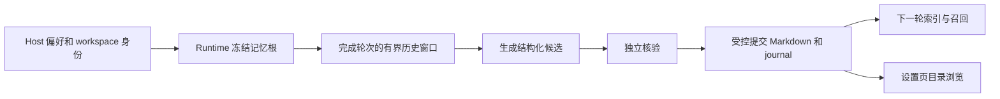

# 工作区记忆目录调查

## 已确认事实

本次只读核查了用户指定的本机 profile、安装目录、目标项目、运行日志和 SQLite；没有编辑个人记忆、运行付费模型或替换安装包。以下使用逻辑路径，省略用户名、会话标识、记忆正文及内部服务地址。

| 边界          | 核查结果                                                                                                      |
| ------------- | ------------------------------------------------------------------------------------------------------------- |
| 安装版        | 安装程序与当前仓库均为 3.17.9；Agent bundle 包含受控自动生成和独立核验流程                                    |
| 开关          | 设置和目标项目启动日志均为 memory enabled/use/extraction enabled                                              |
| 工作区根      | 目标项目正确解析到 `<profile>/.lcode/cli/memories/projects/<project-key>/memory`，没有退回 default            |
| 磁盘          | 目标项目 memory 空；治理 journal/preimages/reviews/staging 空。default memory 有两个 topic                    |
| default 来源  | SQLite 中四次已完成 Write 来自 default 会话：两次 topic，另两次把 MEMORY.md 写在项目 key 根而非 memory 子目录 |
| 设置列表      | 原服务只列有 Markdown 的 profile 项目，所以只显示 default；空项目不是工作区列表来源                           |
| 项目 `.lcode` | 原实现未将 Project Memory 放在这里；这里没有记忆文件不能单独证明故障                                          |

## 自动保存链路

10 月 10–11 日日志中有七个 `project_memory_extract` 物理模型请求，各自有 SDK completed 与 request completed 两条记录，不能算成十四次提取。四个请求为 `finishReason=length` 且正文长度为零；源码严格拒绝这类响应，不能生成可保存的记忆。其余三个为 stop，正文长度分别 328、3658、198；脱敏日志不能确定候选是否为空或后续为何终止。

同轮紧邻的两个请求共享 session/turn/span，符合生成后核验的时序，但现有 wrapper 把阶段都标成 `project_memory_extract`，日志无法独立证明各自阶段。当前增量预算为生成 1536、核验 768 输出 tokens，辅助请求使用模型公开档位最低项。长度上限证据不能进一步证明是推理耗尽或配置映射错误。

SDK 请求完成不等于记忆提交成功。零候选可直接 no-change，核验失败会在 saveReview 前结束；二者都可能不产生 journal。现有数据没有发现目标项目被迁到 default 的证据，也没有找到可据以恢复其旧记忆的记录；不能宣称历史从未被删除。

## 本轮新增行为

用户随后明确要求可选择 profile 或项目内目录，并确认复制已有记忆、保留源。按[存储位置规格](workspace-memory-storage-location.md)实施；这是新增位置能力，不能将其描述为已恢复丢失的正文。

提取阶段与结果的可观察性、真实模型下的输出预算效果属于后续独立改善项，本次没有通过放宽审核、重复付费请求或增加隐式重试来填充空目录。

## 后续自动提取阻塞修复

用户随后提供两个会话要求继续调查，并明确要求修复。按[提取可靠性规格](workspace-memory-extraction-reliability.md)实施；本段与前面的只读调查、位置切换分别记录。

已复现一个字节预算口径错误：SessionStore按原始data列读取不超过262144字节，Core却把补入行ID和外层容器后的JSON按同一上限再次检查。另一个阻塞来自回退cut落到有界窗口外：Core原来无法证明窗口属于新分支，因而跳过。现在由同一SQLite savepoint提供同scope/同generation的锚点顺序证明；缺失或错误证明仍拒绝，不忽略废弃分支保护。

采用Node 24.21.0，只读重放有九个完成窗口的会话：修复前八个`budget_exceeded`、一个空来源；修复后九个均能取得完整当前轮的有界证据。重放没有调用模型或写入个人记忆，不能把“证据可用”当成已生成或已保存九条记忆。

另一会话的两次真实提取均为`length`且正文为空。自动增量总输出上限由1536/768调整为4096/2048，仍受模型公开最大值/context限制，仍最多一次生成和一次独立核验；未增加付费重试。新增稳定`output_truncated`阶段码和脱敏轮后结果日志。真实模型是否足以产生完整正文仍未付费复测，不宣称输出预算效果已完全验证。
