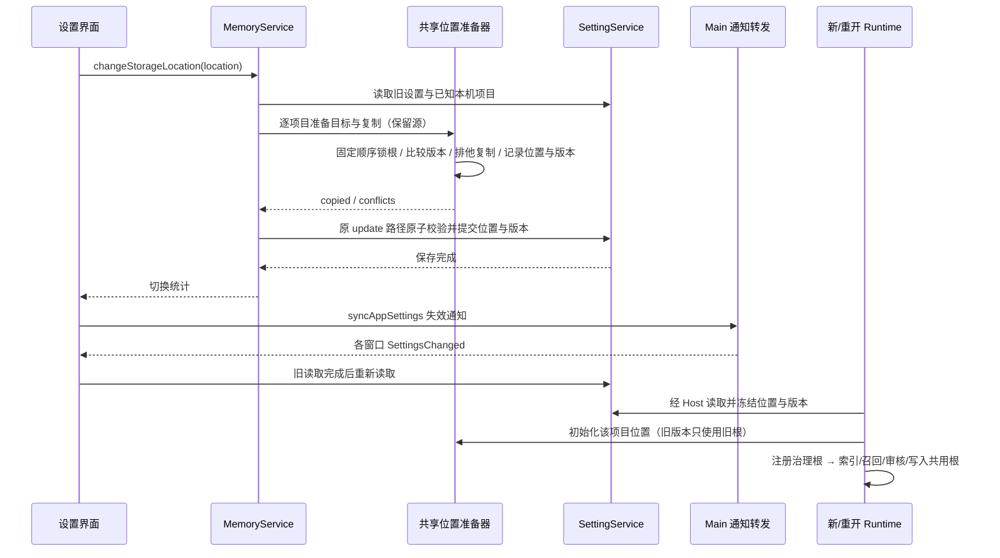

# 工作区记忆存储位置

## 产品规则

- 设置 → Agent 能力 → 记忆增加 `memoryStorageLocation: "profile" | "workspace"`。缺省为 `profile`，保持现有用户数据目录布局；`workspace` 使用本地项目实际根下的 `.lcode/memory`，治理状态仍是旁边的 `.lcode/memory-state`。
- 该选项是本机设置，适用于本机项目，包括 default 工作区和独立 worktree。文件操作以实际 checkout/workspace root 为准，Bash `cd` 不改变记忆归属。
- 多源文件夹项目沿现有 `LocalProject.primaryFolderPath` 作为 workspace root，只在主文件夹存一份项目记忆。`sourceFolderPaths` 的附加文件夹扩展项目访问范围，不各建独立记忆；同一附加文件夹另行打开为独立项目时，按其自己的主根隔离。
- 本地显式非空 identity 使用 `.lcode/memories/<identity-hash>/memory`，旁边各有独立 memory-state；普通 path fallback 仍为 `.lcode/memory`。同一路径不同 identity 不得共享文件。远程 identity 显式请求项目模式时返回不支持；Host 不发送该组合。
- 远程 identity/session 的现有隔离语义保持：远程工作区继续使用其现有 profile 记忆，不能拿远端路径在本机创建 `.lcode`。本版不新增远程项目内存储或远程文件浏览；界面明确选项适用本机项目。
- 用户已明确选择：切换时复制已有记忆，保留源文件。复制当前有效 Markdown（含索引和递归 topic），不复制 owner、锁、journal、review、前像或效果观测账本；这些数据与原绝对根及版本绑定。
- 同名同内容幂等跳过；同名不同内容保留目标，返回冲突数量，源文件仍可查看。不开启覆盖、删除或双向同步。没有源文件时可正常切换，不能声称恢复了历史记忆。
- 切换命令先为已知本机项目准备位置并复制，再通过原 SettingService 保存选项；失败不提交新设置。返回复制/冲突统计，UI 显示结果与失败原因。只读 catalog 不触发复制。
- 最近项目之外或稍后打开的项目，在 Runtime 第一次加载所选位置时用同一复制实现补齐。每个项目记录已准备的位置，重开同一位置不重复从旧目录导入，避免复活已删除的记忆。切回另一位置再次执行保留目标版本的增量复制。
- 已有活动 Runtime 冻结原 memory root；设置影响新建或重新打开的会话，不在进行中的工具调用/审核中切换路径。界面明确生效时机。两个目录之间没有持续同步。
- `SettingService` 同时持有内部单调位置版本 `memoryStorageRevision`（缺省 0），位置真正切换时与选项同次保存。Host 将版本随位置冻结到 Runtime；每项目标记保存已准备版本。旧版本或无版本的旧端在遇到较新标记时只使用自己的旧根，不复制、不回退标记。新版本仍允许尚未枚举的项目在打开时补齐迁移。无版本的独立 CLI 不得覆盖桌面已有的版本标记。
- 初始 workspace root 来自构造参数；冷恢复使用持久 session.path，缺失或空字符串时兼容旧 directory。context snapshot 的 workingDirectory 只决定执行 cwd，不能覆盖项目根；会话证据 scope 读面遵守同一 path 优先规则。
- 设置页继续能查看旧 profile 记忆，并列出已知本机项目的项目内记忆，显示来源位置；选项切换不让原文件消失。读取限制在服务解析的记忆根内，保留稳定文件句柄、大小限制、大小写和 symlink/junction 检查。

## 所有者与接口

- `SettingService` 是选项的唯一持久所有者，沿现有广播同步；UI 只有提交中/错误状态。
- Desktop 切换提交后沿 `syncAppSettings` → Main → `SettingsChanged` 通知各窗口；Main 只发读取失效通知，不保存位置或版本。其他窗口收到后读取原 SettingService，不把读取结果再次广播，避免旧下拉值和回环。
- 原 `SettingService.update` 在设置文件锁内校验位置与版本：位置变化必须携带恰好当前版本加一，同位置的显式版本必须等于当前版本；拒绝缺版本的反向切换、单独推进或回退版本。其他设置补丁保持原行为，不能通过通用设置入口破坏单调性。
- `MemoryService.changeStorageLocation({ location })` 是设置页唯一切换命令，注入 SettingService 与本机项目来源。通过原 setting update 提交，不直接写设置 JSON。服务 catalog 与 Runtime 使用共享 Node 路径解析，不能各造 hash。
- 共享 Node 复制实现是位置准备的唯一文件写入路径，供服务命令与 Runtime 初始化使用；它使用与 Project Memory writer 一致的跨进程根锁，按固定顺序锁住源和目标，验证目录链，复制前检查预算，并以排他创建保留并发产生的目标文件。
- CLI 配置新增 `memory.storageLocation` 与内部 `memory.storageRevision`；Host runtime preferences 传递 `memoryStorageLocation` 和 `memoryStorageRevision`。初始 profile / 版本 0 保持旧报文形状；workspace 选择或正版本显式携带扩展，切回 profile 也必须保留正版本。旧端若无法识别应报不兼容，不能降级成功。
- `workspaceIdentity?.trim() || workspacePath` 仍是身份边界。带远程 identity 的路径继续使用原 profile hash，不跨 scope 复制；本地 project 内位置按真实 workspace root 派生。

Desktop continuous 与手机 replayable 继续复用既有 Host/Runtime。此设置不创建第二 Agent、任务队列或会话所有者；手机不持有桌面项目目录副本。

## 失败与恢复

- 目录不可写、非法位置、路径逃逸、symlink/junction、复制预算超限应明确失败；不能静默切回 profile 并假报成功。
- 复制为保留源的增量操作，不宣称跨多个项目的文件系统事务。中途失败可留下已复制文件，设置仍旧值，重试幂等完成；不会回滚删除用户文件。
- 服务命令已经提交后，Renderer 广播失败只记录同步警告并继续读回设置，不能显示“仍使用原位置”。提交后的读回必须在已有读取完成后重新读取，不能用提交前的 in-flight 快照完成切换反馈。设置页卸载或关闭记忆后，旧复制回调不能重新启动 catalog 读取或应用过期列表。
- 提交后的设置读回失败时，保留最后可读的设置快照并显示“切换未能确认”，不显示完整成功或宣称服务已回滚；重开设置页可再次确认。多个等待旧读取的刷新调用，在旧请求完成后共享同一新读取；普通非提交刷新保留既有失败不抛出的行为。
- 若复制已完成但设置提交失败，旧位置仍为权威；重试必须补齐失败期间在旧位置新增的记忆。显式切换以 SettingService 读出的旧位置判定来源，不能因预备标记已推进而跳过复制。成功后同位置重开仍不得复活删除的文件。
- 位置版本比较、复制和标记提交必须在同一 profile writer 锁中完成；设置提交失败后的显式重试复用下一版本，并按旧权威位置补齐复制。旧 Runtime 的延迟首次初始化不得回退新标记，两个切换方向都要验证。
- 标记兼容旧 `schemaVersion:1` 无版本格式；有版本调用写 `schemaVersion:2` 与安全非负整数 `storageRevision`。协议旧报文缺版本由 CLI 解释为数值 0；独立 CLI 无版本则保持未版本化，遇任意 v2（含版本 0）只使用其自选根、不复制或写标记，显式迁移命令则拒绝。数值同版本不同位置明确冲突；显式切换命令比标记版本旧也拒绝，不能报告迁移成功。失败重试只有同版本同目标时可按显式旧来源补齐。独立 CLI 未携版本且标记也无版本时保留旧位置迁移行为；较新版本的 Runtime 仍可迁移未枚举项目并提交新标记。
- 每项目复制最多 256 个 Markdown、扫描 1024 个目录项、深度 8 层、单文件 256 KiB、总正文 16 MiB；越界明确失败，不悄悄截断迁移。
- 位置标记在本机 profile 中按原 workspace key 保存；不随项目提交。默认旧 profile 在没有位置标记时不自动导入任意项目文件，选择 workspace 后才开始对应迁移。
- 不自动更改 `.gitignore`。项目内记忆属于项目文件，是否纳入版本控制由用户决定。

## 验收场景

1. 缺省/旧设置保持 profile；两种枚举可持久化，非法值被拒绝，关闭记忆时仍可配置位置。
2. 本地根、带空格路径、Windows 大小写、worktree、Bash cd、identity 路径均符合上述边界；远端路径不触发本机项目写入。
3. profile→workspace→profile 复制 Markdown 并保留源；递归 topic/索引、重复调用、同名内容冲突、空目录和稍后打开项目有确定结果。
4. 不复制治理状态；符号链接、目录逃逸、只读目标、部分失败与并发写入不能覆盖目标或删除源。
5. 设置失败保持原枚举；成功后目录展示两处来源，刷新可在空态/错误态操作；新 Runtime 索引、召回、受控写入与自动审核都使用同一所选根。
6. 浏览器验证宽屏/窄屏、键盘选择、中英文、全部主题、进行中禁用、失败反馈与成功刷新。390px 已开启记忆列表的搜索框须占可用行宽，不能被工作区选择和数量挤成图标宽度。
7. 执行定向服务/CLI/协议测试和浏览器场景，再运行根及 CLI typecheck/lint、架构与改动文件格式检查；真实安装包未重建前不宣称已部署。
8. 真实界面与 hook 验证已提交后的广播错误、提交前设置读取晚到、复制期间卸载，服务设置仍是唯一已接受位置，不增加第二份 accepted 状态或重复切换命令。
9. 旧 profile / workspace Runtime 延迟首次初始化时不触发反向复制或回退版本；新位置删除的文件不因旧 Runtime 启动而复活。未列入最近项目的合法较新位置版本仍能延迟迁移；设置写失败后相同下一版本可重试。

## 执行记录（2026-10-11）

使用仓库固定的 Node 24.21.0、pnpm 10.34.6，在临时数据目录验证，不替换安装程序、不修改用户个人记忆。以下分组不与 Metis 旧验收组累加。

| 验证组                                               | 结果                       | 主要边界                                                                                 |
| ---------------------------------------------------- | -------------------------- | ---------------------------------------------------------------------------------------- |
| 共享路径与复制准备器                                 | 16/16                      | 复制保留源、冲突、递归、链接与预算、并发锁、v1/v2 标记、旧 Runtime/无版本 CLI            |
| 记忆服务、设置、Host 与协议（8 文件）                | 27/27                      | 主文件夹、目录浏览、远程隔离、失败重试、版本成对提交、版本上界及双向延迟初始化           |
| CLI 配置、Node 端口、Runtime 与历史 scope（10 文件） | 42/42                      | 真实 Bash/Node 子进程、SQLite 冷恢复、旧 path 兼容、版本透传、双向旧 Runtime 不复活文件  |
| 旧 profile catalog 回归                              | 1/1                        | 原记忆目录和文件仍可读取                                                                 |
| 设置组件 SSR                                         | 3/3                        | 关闭记忆时仍可配置位置，历史召回开关与说明保持兼容                                       |
| Desktop Main 真实通知入口                            | 4/4                        | 严格 IPC 校验、所有存活窗口单次通知、原生设置路由无回归                                  |
| 真实共享组件与 hook 浏览器                           | 11/11（10 子场景及父测试） | 1280px/390px、中英文、7 主题、键盘、失败反馈、卸载、并发刷新、接收窗口旧读取晚到且不回环 |

CLI 全量 typecheck 27/27、lint 14/14 通过；typecheck 包含 contracts、adapters、core、bootstrap 最新构建。Turbo 仍报告既有 lockfile workspace 闭包警告，不影响本轮退出码。

根 `pnpm typecheck`、`pnpm lint` 通过；架构检查为 0 violations / baseline 0 / new 0。类型检查曾发现纯设置校验辅助函数不应接收整个 `Partial<AppSettings>`，已收窄为位置和版本两字段后重跑通过。已有 Goal 验收组在最新 CLI 构建后复验 42/42。

关键回归入口：[共享准备器](../packages/shared/src/projectMemoryStorage.test.ts)、[服务切换](../packages/services/src/memory/memoryStorageLocation.test.ts)、[设置所有者](../packages/services/src/setting/memoryStorageLocation.test.ts)、[真实 Runtime](../apps/lcode-cli/packages/bootstrap/src/app/project-memory-storage.integration.test.ts)、[Main 通知](../packages/desktop/src/main/desktopImmediateAppSettings.test.ts)、[浏览器场景](../packages/web/test/memory-settings.test.mjs)。

安装版尚未重建或替换；本轮是源码与测试环境验收。浏览器使用真实组件和确定性服务 fixture；真实磁盘、Bash 和 SQLite 在临时目录运行，不能替代付费模型效果、手机实机及其他操作系统的验证。全仓历史格式问题和另一路并发远程连接改动不在本次格式修复范围，定向格式结果见[汇总记录](metis-capability-adoption-audit-2026-10-11.md)。
