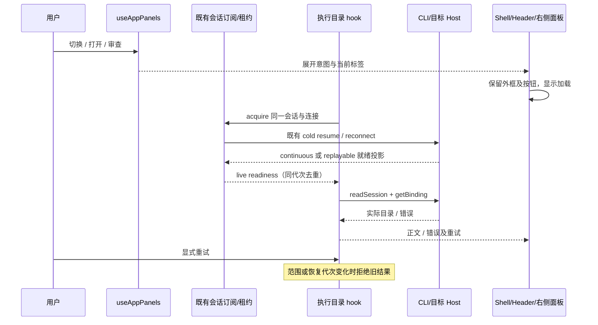

# 右侧面板与冷会话恢复

## 问题与产品规则

2026-10-12 已通过源码、运行日志与浏览器复现确认：冷会话切换时，执行目录 hook 的
`readSession` 可早于 V4 订阅恢复，返回 `Session is not active`。聊天随后恢复成功，但目录
hook 没有恢复信号，Shell 因目录为空不挂载面板；展开状态又让顶部按钮隐藏。

- 顶部切换、会话产物“打开”和文件摘要“审查”均沿用 `useAppPanels` 的打开路径。
  明确打开后，右侧外框立即可见；等待会话/目录时显示加载状态，失败显示错误及“重试”。
- 加载和失败不清空标签页、不改变用户展开意图，不隐藏顶部切换按钮和 Windows/Linux
  窗口控件。用户仍能关闭、重新打开面板；恢复成功显示已选中的文件或审查。
- 执行目录未知时不以原项目路径执行 Git、终端或文件操作。状态提示不暴露协议细节。
- 目录读取必须在共享 V4 会话订阅就绪后进行；失败可显式重试，恢复事件可自动重新读取。
  禁止 sleep、轮询或固定延迟重试解决冷恢复时序。

## 所有者、接口与边界

- CLI/目标 Host 是会话与实际执行目录的事实所有者；现有 workspace connection /
  SessionDataLayer 的引用计数租约共享冷恢复、订阅与 readiness，不创建新 Agent 或 Host。
- `useActiveExecutionWorkspace` 只持有当前范围的目录读取结果、错误与未完成读取；通过
  原项目 identity/path、remoteSessionId 租用既有连接，收到 live 投影后读取原 session
  service 与 worktree binding。提供幂等的显式 retry 入口；同一就绪代次不因流式 chunk
  重读目录。恢复/服务换代/工作树生命周期使旧请求失效。
- `useAppPanels` 仍是展开状态、标签页、归属与偏好的唯一所有者。Shell/面板只投影这些
  状态，新增的 pending/error/retry 参数不成为第二份面板显隐状态。
- Shell 保持右侧 Panel 挂载，将目录状态交给面板的加载/错误展示层；未知目录不挂载
  依赖执行环境的正文。Header 只在面板可用时把切换及窗口控件交给右侧标题栏。
- 原项目 `workspaceIdentity?.trim() || workspacePath` 隔离连接及标签；真实 workspacePath
  用于执行。相同路径不同 identity、attachment/service、会话和生命周期均丢弃迟到结果。
- 不改协议、业务持久化或命令 admission。桌面 `desktop-continuous` 与手机
  `web-remote-replayable` 复用既有 transport 和恢复语义；手机使用既有抽屉与焦点边界。

## 回归验收

1. 冷恢复未完成时分别点击切换、“打开”和“审查”：外框可见、顶部切换可见、加载状态
   可见、读取实际目录的调用数为零。恢复完成后显示正确文件/审查，且同会话共享一次订阅。
2. 目录或订阅失败时三个入口均显示错误及重试；关闭/再打开不丢目标。修复服务并重试后
   不必切换会话即可恢复正文；按钮和窗控始终可访问。
3. 切换会话、相同路径不同远端 identity/attachment/service，以及工作树生命周期变化：
   旧结果不能覆盖新目录，Git/文件调用仍用正确实际路径与 identity。
4. 面板已展开时目录失效并恢复，Panel DOM/布局仍在；普通 Git 刷新和流式增量不重读目录、
   不重置尺寸、不触发额外订阅。
5. 1280px 桌面与 390px Web、中英文，以及两种 delivery kind 的真实生产 hook、面板和
   Header 接线浏览器场景；失败、关闭、重开、重试及恢复后操作有真实几何与 DOM 断言。
6. 修复前执行新增回归确认失败，修复后执行新增回归与已有 Git 刷新、远端身份、审核导航
   回归，并运行 typecheck、lint、格式及架构检查。保留真实失败记录与环境限制。

## 验证记录（2026-10-12）

- 新增 `side-pane-recovery.test.mjs`：修复前六个入口/宽度组合均失败；修复后六个组合及
  两个订阅失败重试场景通过，共八个子场景（含顶层计九项）。覆盖真实生产 hooks、共享
  连接/会话租约、Header、Panel/抽屉、文件预览、Git 审查、错误后关闭/重开/重试、同一
  Panel DOM 保留和普通 Git 刷新不重读目录。服务事实使用确定性桩，不读取用户仓库。
- UI 单测三项（窗口控件/切换入口与 Shell 接线）通过；连同既有 mobilePanelIntegration
  六项和 continuous/replayable 恢复投影五项，十四项全部通过。
- `git-session-refresh.test.mjs` 六项、`sidebar-file-tree.test.mjs` 六项通过，保留提交后
  目录/监听/子会话稳定性、相同路径不同远端 identity/Host/service 的迟到结果隔离。
- 完整提交审核浏览器回归通过；工作树完整回归最终重跑三十九项全部通过。首次组合运行
  工作树有两项失败：旧分叉桩覆盖会话服务并丢失订阅/帧监听；补齐桩的就绪契约后完整
  重跑通过，没有修改生产路由或删除断言。
- `pnpm typecheck`、`pnpm lint`、`pnpm verify:pre-push` 通过；架构 baseline/new/total
  均为零。本次文件的 oxfmt 检查通过，feature graph YAML、85 个唯一节点和 122 条关系
  端点校验通过。本次 diff 空白检查通过，未修改其它本地改动中的 patch 空白问题。
- 本机 Node 为 24.14.1，`mise.toml` 指定 24.21.0 且 mise 不在 PATH；以上是当前本机
  实际执行结果。未构建/替换已安装桌面应用，未执行 macOS/Linux 或实体手机实机测试。
