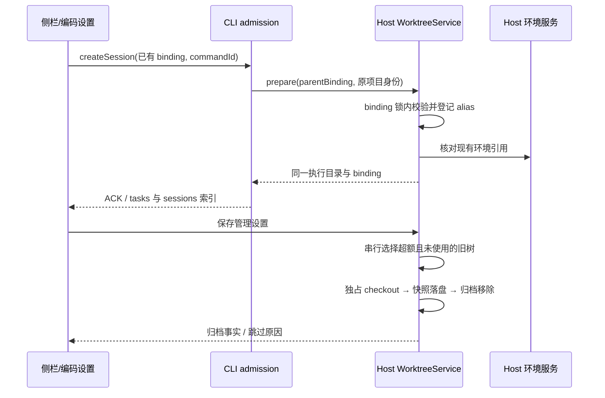
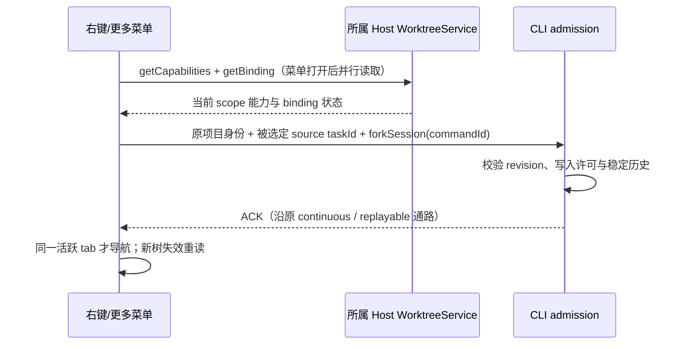

# 工作树侧栏与编码设置（2026-10-11）

## 产品规则

- 设置增加「编码」分组，其下「工作树管理」「环境」是两个并列页面。管理详情在页面内展开，不再打开工作树管理弹框；提交合并审核仍使用原审核流程。
- 侧栏每棵树与项目相同，可折叠会话。单行显示折叠按钮、分支名、状态图标、打开文件夹、新任务；完整路径和状态通过无障碍名称及提示读取。加号创建空白任务，不复制历史、不新建 checkout；右键菜单提供派生与管理，手机可通过更多菜单访问。
- 新任务属于原项目，由 createSession 的 execution.existingBinding 指定已有 binding 和 owner task。CLI 通过 Host prepare(parentBinding) 注册同树 alias；校验原项目 identity、binding owner、ready 状态和执行环境。不得直接把 checkout 当普通项目或新 Host；不复制父会话消息。失败保留原命令，禁止降级为本地目录或另一工作树。
- 工作树管理提供原项目选择、查询、创建、显示名称编辑、归档/恢复和确认永久删除。名称只影响展示，不能改写 Git 分支或身份。归档快照保留聊天，永久删除继续遵守原精确会话清理流程。
- 管理页「新建工作树任务」进入原项目的空白工作树草稿，首次发送时创建 checkout，与既有准备/取消链路一致；不为只打开草稿创建孤立目录。
- 常规设置：自动删除旧工作树默认开启，保留数量默认 10，范围 1–1000；超额按创建时间从旧到新清理，最近的保留数量始终保护。旧树忙碌时允许暂时超额，不转而清理新树。自动删除是可恢复归档，不调用永久 discard。当前新建/恢复/使用中的树、非 ready 树、有未完成集成或快照无法保存的树跳过；失败不伪报成功，不影响新任务创建。
- 根目录选择默认、自定义、项目内。自定义留空使用默认位置；项目内为仓库根目录 `.lcode/worktrees/checkouts`。位置仅影响新树，已有树和恢复使用持久化的原位置。目标 Host 解析路径和检查符号链接、根边界、Git 登记；Renderer 不拼接物理目录。
- 环境页按原项目设置后续新工作树的本机/托管策略，并列出当前树的真实环境。复用环境详情中的刷新、升级、资源扫描和服务管理。已存在树不因默认策略改变而静默迁移。

## 所有者与接口

- 折叠与显示选择是本端 UI 偏好；任务事实属于 CLI 索引。WorktreeService 唯一拥有绑定、显示名称、创建根目录、清理设置及归档记录，配置保存在原 Host 数据目录，不把 checkout 位置变更当数据目录迁移。
- IWorktreeService 增加 getManagementSettings/updateManagementSettings、rename、cleanup；运行时验证严格 schema，局部设置补丁原子合并。prepare 成功或保存自动删除开关/限制后触发同一 owner 清理流程，手动恢复不立即重新归档自身；跳过项在后续创建或手动清理时重试。
- existingBinding 是 additive execution intent；旧创建路径不变，已有树必须返回所请求 binding，不能因为旧端忽略字段而创建新树。
- 空白同树会话的持久 workspace 引用记录 `bindingOwnerTaskId` 和 `bindingReuse: existing`。恢复必须以自身 taskId 查询 Host 的 alias 并与根 owner 对账，不创建父会话关系。真正的会话派生去掉该标记，继续校验 SessionStore 的真实 parent/child 链；Host alias 缺失时拒绝恢复，不能只凭传入根 owner 放行。
- 本地和远端沿原 workspaceIdentity?.trim() || workspacePath 路由，并携带 remoteSessionId；断连不回退本机。Desktop continuous 和手机 replayable 沿现有 createSession / ACK / snapshot，新增 UI 不拥有已接受状态。

## 验收

1. 两棵树各有多个任务，折叠互不影响；刷新保持折叠；桌面和 390px 单行不溢出，状态有可读提示，文件夹使用真实 checkout 路径。
2. 加号生成空白同树任务；派生保持既有复制语义且仅在菜单；已归档/断连不可新建。
3. 设置两个入口可直接导航，工作树详情内嵌；搜索、名称编辑、归档恢复和永久删除均作用于选定 owner。
4. 设置持久化并严格验证数量与路径；修改根目录后旧树仍可归档恢复，新树使用新位置；项目内与自定义路径不突破删除边界。
5. 超额清理先快照，保留修改与会话；忙碌、未完成合并、忽略内容需确认和快照错误均不强删；关闭清理不删除。
6. 同路径不同远端 identity 分离；原 requestId 重试无重复创建；管理页切换 scope 后晚到结果不覆盖新 scope。

## 右键菜单复核（2026-10-11）

- 工作树行的右键与更多菜单共用同一组动作：新建空白会话、同树派生、新树派生、打开工作树文件夹、复制工作树路径、进入工作树管理。重命名、归档/恢复、永久删除仍由设置页承担，不在树行复制危险入口。空白会话不复制历史，派生明确提示复制哪个会话的历史。
- 树行派生只使用 binding.taskId 对应的原始会话；该会话未出现在当前列表时禁用，并提示在具体会话上派生，不能随列表排序改用第一条子会话。菜单提示显示来源会话标题。
- 两种菜单沿同一 useTaskFork 读取所属 Host 的能力与 binding。查询期间/失败/远程断连不可启用未确认的操作；新树还必须满足 create 能力，已归档/准备中/缺失 binding 不可派生。同树派生不要求新建 checkout 能力。关闭菜单停止采纳迟到查询，切换 scope 不复用旧能力；CLI 继续最终校验 busy、版本及许可。
- 工作树内会话保留原有会话菜单：派生、交接、置顶、重命名、归档、未读、路径/会话 ID、轨迹及反馈。会话管理命令使用被右键会话的原项目身份；归档会话不归档或删除工作树。交接/分屏遵循已有接收方与平台可用性。树行菜单不得触发或复用上一次会话菜单。
- 「复制工作树路径」「在文件管理器中打开工作树」使用会话 owner 的实际执行目录；普通会话仍使用项目目录。默认、置顶、时间线、分组和顶部更多菜单采用同一个路径解析 hook，菜单打开才读取工作树目录；加载、断连、绑定缺失或未就绪时禁用，不回退原项目。远端目录仍由原项目的 Host/原生目标解析，不能当本机路径打开。树行复制已知 checkout 根路径，文件夹入口打开该 checkout；工作树里的子项目会话使用自己的实际 cwd。
- 「复制会话文件路径」只在服务确认文件存在时显示，避免复制当前版本合成却不存在的 `.lcode-session` 路径。日志路径和会话 ID 仍使用所选会话的 owner 接口；日志文件允许尚未落盘但路径已确定。反馈不得填入不存在的会话文件路径。
- 验收补充：桌面与 390px 逐项点击树行及会话菜单，验证源 taskId、命令的原项目身份、文件操作的实际工作树 cwd、两种 fork 模式、设置目标；能力拒绝/归档/源会话缺失禁用；更多与右键一致；重复打开与 Escape 不折叠或选中会话；会话归档后其它会话、工作树文件绑定保持不变。
- 窄屏菜单遵守共享弹出组件提供的实际可用宽度，长文案折行；不能用整个视口的宽度覆盖点击位置旁的可用宽度。验收同时检查菜单边界和选项内容无裁切。

## 实施验证（2026-10-11，Windows）

- 修改涉及 worktree、runtime-environment、shared、UI 和 CLI；状态所有者与事件顺序见上文。工作树服务模块相对当前 HEAD 新增 537 行、删除 28 行，净增 509 行（包含新增文件；不包含其它模块）。
- 最终使用 `volta run --node 24.21.0`：根目录 `pnpm typecheck`、`pnpm lint`，CLI `pnpm --dir apps/lcode-cli typecheck` 和 `lint` 均通过；架构检查 baseline 0 / new 0；定向格式检查通过。
- 工作树服务完整回归 123/123 通过（该轮使用本机 Node 24.14.1）。切换到规定版本后，管理集成 6/6、CLI 创建/恢复与派生、环境释放和草稿状态专项 29/29 通过。
- `packages/web/test/worktree-sidebar.test.mjs` 2/2 通过，每项覆盖 1280px 与 390px：折叠持久化、单行布局、文件夹目标、同树新任务、右键派生入口、设置导航、删除重试、名称/搜索、目录和数量配置、归档恢复、环境策略与无横向溢出。已查看浏览器截图；夹具通过真实 UI/hooks 调用服务替身，Git 与删除边界由真实临时仓库集成测试覆盖。
- 未进行 macOS/Linux 实机或打包安装验证。现有 CLI 检查仍提示部分 workspace 不在 lockfile 中；未修改无关依赖与锁文件。

## 右键复核验证结果

- 本轮修改集中于共享 UI 菜单、路径解析 hook、工作树行、双语文案和 Web 交互夹具；未增加服务写入或改变 owner/admission。8 个原有通用菜单文件相对 HEAD 净增 49 行；新门禁 hook、已有未提交工作树行和测试/文案另计，未混入其它任务的工作区改动。
- 浏览器用例分批覆盖 43 项（含父测试）：工作树 UI 套件 39 项、侧栏/设置 2 项、右键/更多菜单 2 项通过。覆盖桌面/390px、实际 checkout 路径、会话 ID/文件/日志、置顶/重命名/未读/归档、轨迹/反馈请求、不可用交接/分屏、两种派生、固定来源、能力拒绝、归档/读取失败、无横向裁切和设置页导航。平台原生动作由服务替身记录参数，未执行原生资源管理器或跨平台打包验证。
- 完整并行运行曾有 1 项 Vite 首次页面加载超过 10 秒；仅将测试导航超时改为 45 秒，交互断言仍为 10 秒，菜单两项重跑通过。此前等待旧管理弹框的两条夹具已改为内嵌设置页，并在完整工作树 UI 套件重跑通过。截图发现的窄屏裁切已修正，最后菜单回归与截图边界断言再次 2/2 通过。
- 最终 `pnpm lint`、架构 baseline 0 / new 0、定向格式检查通过。根 `pnpm typecheck` 本轮前几次通过，最后一次在并行发生的 GitBackup 改动上失败：`GitBackupSection.test.tsx:38` 的 availableWorkspaces 可空类型、`GitBackupSection.tsx:190` 的 GitBackupStatusPanel 缺少 workspaces/target/remove。未修改这两个无关文件，也未把该次检查记为通过。
